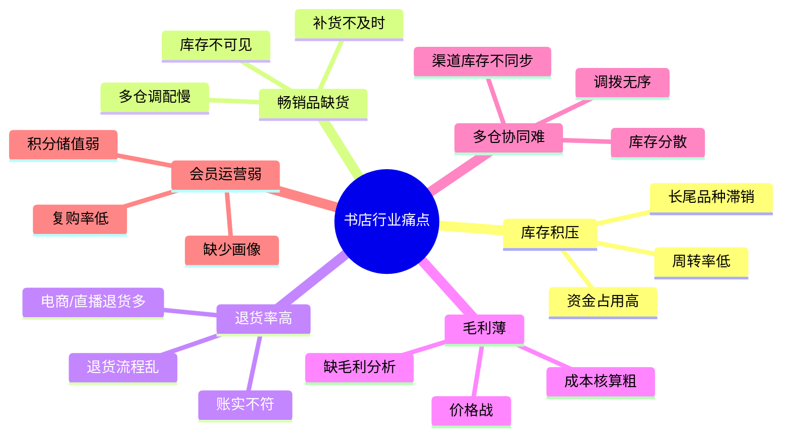
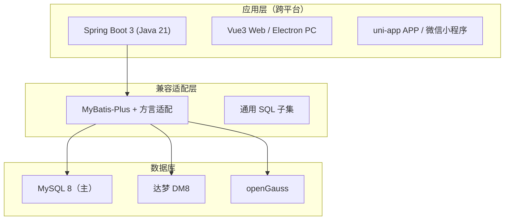

# 01 · 行业分析（书店行业）

> 本章从行业现状与规模、渠道变迁、竞争格局、行业痛点、数字化转型、政策与信创背景六个维度分析书店行业，并给出**本项目对行业痛点的解决思路**。数据为基于行业公开资料的**行业性量级描述**，用于说明趋势与决策依据。

---

## 1. 行业现状与规模趋势

### 1.1 图书零售市场规模

- 全国图书零售市场（含线上）年度码洋规模长期处于**千亿元量级**（近年约 900～1200 亿元区间波动），线上渠道占比已超过 **75%**，实体书店渠道占比压缩至约 20%~25%。
- 图书是典型的**低单价、低毛利、高 SKU、高频次**商品：图书零售毛利率普遍在 **15%~30%**，教材教辅类更低；单册平均码洋约 **40~60 元**。
- SKU 极度分散：一家综合书店在售品种常达 **数千至数万个**，长尾品种动销率低，库存周转压力大。

### 1.2 实体书店的"场景化"转型

实体书店从"卖书场所"转向"文化空间 + 零售 + 咖啡文创 + 会员社群"的复合业态：

- **体验与场景**：阅读空间、活动签售、咖啡文创提升到店率与客单价。
- **会员运营**：通过会员等级、积分、储值沉淀私域流量（本项目 `base_member_level` / `base_customer` 支撑）。
- **线上线下一体**：门店仓 + 中心仓 + 网店仓多仓协同（本项目 `base_warehouse` + `psi_stock` 多仓模型）。

### 小结 1

图书零售市场**总量可观但增速放缓、利润微薄**，行业竞争从"规模扩张"转向"精细化运营"；数字化进销存是**降低库存资金占用、提升周转与毛利**的核心抓手。

---

## 2. 图书零售渠道变迁

### 2.1 渠道演进阶段

### 2.2 各渠道特征对比

| 渠道 | 占比量级 | 客单价 | 毛利 | 核心能力要求 |
|---|---|---|---|---|
| 实体书店 | ~20%~25% | 中（含文创） | 中高 | 库存可见、POS 快速收银、会员运营 |
| 传统电商 | ~40%~50% | 低 | 低 | 库存同步、订单履约、多仓发货 |
| 直播电商 | 快速上升 | 低 | 极低（价格战） | **爆品突发性备货、极速出库、退货处理** |
| 私域/小程序 | 上升 | 中 | 中 | 会员积分、储值、复购分析 |

### 2.3 渠道变迁对系统的要求

- **多渠道统一库存**：同一 SKU 在多仓/多渠道的可用量必须准确，避免超卖。
- **突发流量应对**：直播爆品瞬时订单激增，要求出库高效且库存强一致。
- **退货高频**：直播/电商退货率远高于门店，退货单（采购退货 `PURCHASE` / 销售退货 `SALES`）流程必须顺畅。

### 小结 2

渠道从单一门店走向**全渠道并行**，系统必须具备**多仓库存统一视图、快速出库、灵活退货**能力（本项目库存中心 + 出货/退货模块直接对应）。

---

## 3. 竞争格局

### 3.1 竞争主体

| 类型 | 代表 | 竞争特点 |
|---|---|---|
| 国有新华系 | 新华书店 | 教材教辅垄断、网点密、渠道稳 |
| 民营连锁 | 西西弗、言几又、page one | 场景化、与商业地产绑定 |
| 电商巨头 | 当当、京东图书、淘系 | 价格战、履约能力 |
| 内容平台 | 抖音/快手图书 | 流量驱动、爆品逻辑 |
| 区域中小书店 | 各地中小门店 | 数字化能力弱、信息化短板明显 |

### 3.2 中小书店的数字化洼地

占行业数量大多数的**区域中小书店**，信息化程度普遍偏低：

- 仍以**手工台账 / Excel** 记录进销存，库存账实不符时有发生。
- 缺少统一的**成本核算**与**毛利分析**，定价与备货依赖经验。
- **多仓/多渠道**协同能力缺失，畅销品缺货与滞销品积压并存。

### 小结 3

行业竞争激烈，**中小书店的信息化短板 = 本项目的机会点**；轻量、易用、低成本、可信创部署的进销存系统具有明确市场空间。

---

## 4. 行业痛点

### 4.1 六大核心痛点

### 4.2 痛点量化描述

| 痛点 | 现象 | 业务后果 | 量化表现 |
|---|---|---|---|
| 库存积压 | 长尾书动销差 | 资金占用、库龄老化 | 部分品类周转率 < 2 次/年 |
| 畅销品缺货 | 补货依赖人工判断 | 丢失销售机会 | 缺货率可达 10%+ |
| 退货率高 | 直播/电商退货多 | 反向物流成本高 | 部分渠道退货率 > 20% |
| 毛利薄 | 价格战 + 成本核算粗 | 利润被侵蚀 | 毛利率常 < 20% |
| 多仓协同难 | 库存分散不可见 | 超卖/积压并存 | 账实差异常见 |
| 会员运营弱 | 数据割裂无画像 | 复购与私域弱 | 复购率偏低 |

### 小结 4

六大痛点本质是**"库存看不见、成本算不清、渠道管不住、会员留不住"**，亟需一体化系统支撑。

---

## 5. 数字化转型方向

### 5.1 转型路径

| 方向 | 传统做法 | 数字化做法 | 本项目对应 |
|---|---|---|---|
| 库存可见 | 手工台账 | 实时多仓库存 + 预警 | `psi_stock`、`/api/stock/**`、UC28~UC29 |
| 成本精算 | 估价 | 移动加权平均成本 | `avg_cost`、统计 17/18 |
| 采购智能 | 凭经验 | 低库存预警驱动补货 | `/api/stock/warnings`、统计 13 |
| 全渠道出库 | 分渠道手工 | 统一出货 + POS 收银 | 出货模块、UC22~UC25 |
| 盘点高效 | 全盘停业 | 扫码盘点 + 循环盘 | `CK` 单、UC30~UC31、二维码 |
| 退货规范 | 无单退货 | 采购/销售退货单据化 | `RT` 单、UC21/UC27 |
| 经营分析 | 无报表 | 22 统计 + 15 报表 | [04][05] 文档 |
| 多端作业 | 仅 PC | PC + APP + 小程序 | 四端方案 |

### 5.2 数据驱动经营

### 小结 5

数字化转型的本质是**"业务单据化 → 数据台账化 → 决策数据化"**的闭环，本项目正是该闭环的工程化落地。

---

## 6. 政策与信创背景

### 6.1 政策与规范

- **国家信息化与数字经济政策**：推动中小企业上云用数赋智，鼓励传统零售数字化改造。
- **出版发行行业规范**：图书常以 **ISBN** 为唯一标识（本项目 `base_book.isbn` 唯一键），条码/二维码为流通基础设施。
- **数据合规**：个人信息保护要求会员手机号、消费数据合规采集与最小化使用（本项目敏感字段最小化采集 + 审计）。

### 6.2 信创（信息技术应用创新）背景

- **操作系统**：麒麟 Kylin、统信 UOS、鸿蒙 HarmonyOS 在政务/国企/行业逐步普及。
- **数据库**：达梦 DM8、openGauss 替代 MySQL 成为主流国产库选择。
- **芯片与 JDK**：鲲鹏（ARM）、飞腾（ARM）、龙芯（LoongArch）+ 毕昇 JDK / 龙井 JDK。
- **对系统的要求**：技术栈须**可移植、可适配**，数据库层需**SQL 兼容层**，前端须**可在国产 OS 运行**。

### 6.3 本项目信创策略

### 小结 6

政策鼓励数字化，信创要求国产化；系统必须**以通用 SQL 子集 + 适配层**实现"一次开发、多库运行"，详见 [10-信创适配方案](10-信创适配方案.md)。

---

## 7. 本项目对行业痛点的解决思路

| 行业痛点 | 解决思路 | 落地模块 / 用例 |
|---|---|---|
| 库存积压 | 库存金额/库龄分析（统计 16、报表 R09），识别滞销 | [04-查询统计](04-查询统计设计.md) |
| 畅销品缺货 | 安全库存 + 低库存预警（`quantity < safety_stock`） | UC29、`/api/stock/warnings` |
| 退货率高 | 采购/销售退货单据化，影响库存与流水 | UC21、UC27、`psi_return_*` |
| 毛利薄 | 移动加权平均成本 + 单品/月度毛利分析 | 统计 15/17/18、报表 R11 |
| 多仓协同难 | 多仓库存模型 + 调拨单 | UC33、`psi_stock_transfer_*` |
| 会员运营弱 | 会员等级/积分/消费排行/活跃分析 | 统计 19/20/21、报表 R12/R13 |
| 盘点低效 | 二维码 + 扫码盘点 + 差异调整 | UC31/UC32、`CK` 单 |
| 数据割裂 | 统一库存流水台账 `psi_stock_flow` | 报表 R14、统计 22 |

### 结论

书店行业**规模大、利润薄、SKU 多、渠道杂、库存资金占用重**。本项目以「**实时库存可见 + 移动加权平均成本核算 + 多仓协同 + 扫码高效作业 + 数据化经营分析**」为设计主线，针对性解决六大行业痛点，并以**信创兼容**保障在国产化环境下的可持续交付，具备明确的行业价值与落地可行性。