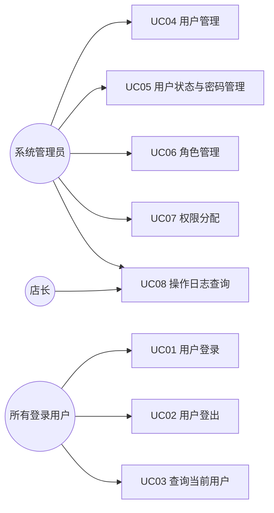
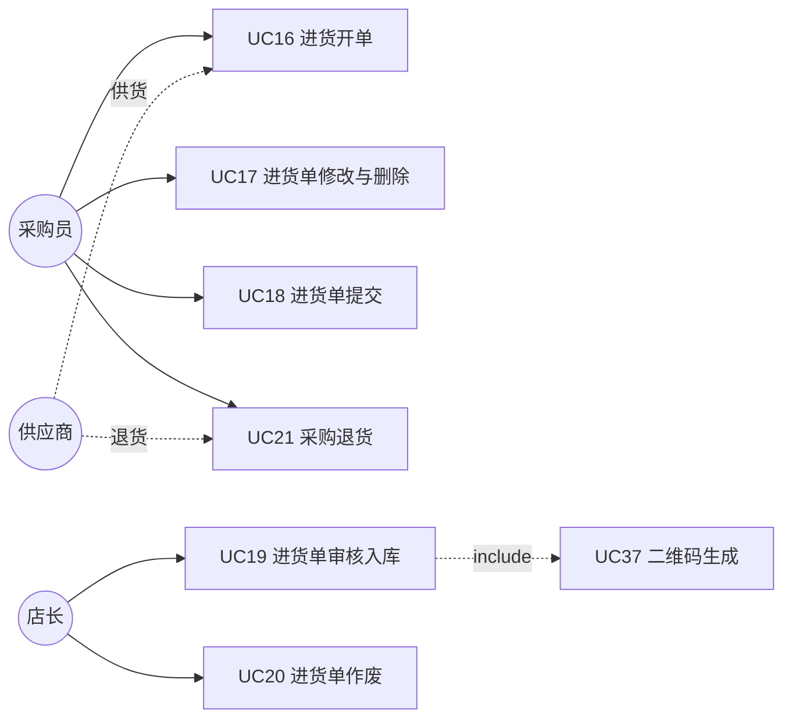
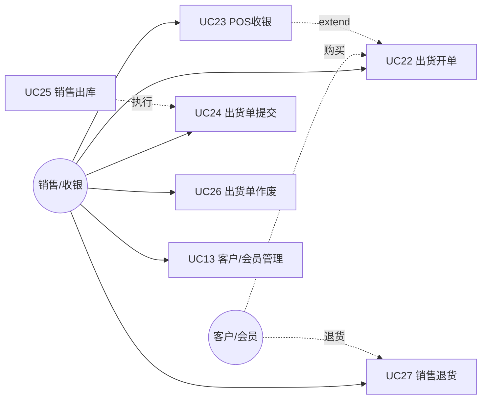
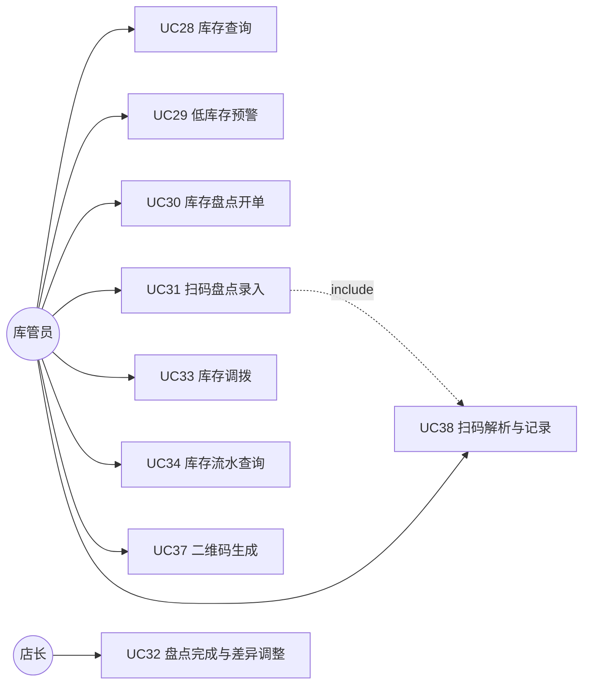

# 02 · 需求分析与用例

> 本章给出「晓镜书阁 · 书店进销存管理系统」的参与者定义、总用例图与分模块用例图、**40 个用例（UC01~UC40）**的清单与描述卡，以及非功能性需求。
> 用例与 [09-接口设计](09-接口设计.md) 的 REST 契约一一对应，表名/字段/单号前缀与 `02-database/schema.sql` 严格一致。

---

## 1. 参与者（角色）说明

| 参与者 | 对应角色编码 | 系统内用户 | 职责概述 |
|---|---|---|---|
| 系统管理员 | `ADMIN` | admin | 拥有全部权限：用户/角色/权限、字典、日志、全部业务 |
| 店长 | `MANAGER` | manager | 门店经营管理：审批入库、查看统计报表、库存盘点 |
| 采购员 | `PURCHASER` | buyer01 | 图书/供应商维护、进货开单与提交、采购退货 |
| 销售/收银 | `SALES` | cashier01 / sales02 | 出货开单、POS 收银、销售退货、会员积分 |
| 库管员 | `STOCK` | stock01 | 库存查询、盘点、调拨、流水、扫码作业 |
| 供应商（外部） | — | — | 供货方，作为进货单、采购退货的往来单位（非系统用户） |
| 客户/会员（外部） | — | — | 消费方，作为出货单、销售退货的往来单位（非系统用户） |

> 角色与权限的数据来源为 `sys_role` / `sys_user` / `sys_permission` / `sys_role_permission` / `sys_user_role`，初始化见 `data.sql`。

---

## 2. 用例图

### 2.1 总用例图

```mermaid
graph LR
    Admin(("系统管理员"))
    Manager(("店长"))
    Buyer(("采购员"))
    Cashier(("销售/收银"))
    Stock(("库管员"))
    Supplier(("供应商"))
    Customer(("客户/会员"))

    subgraph Auth["认证与用户"]
      UC01["UC01 用户登录"]
      UC02["UC02 用户登出"]
      UC03["UC03 查询当前用户"]
      UC04["UC04 用户管理"]
      UC05["UC05 用户状态与密码管理"]
      UC06["UC06 角色管理"]
      UC07["UC07 权限分配"]
      UC08["UC08 操作日志查询"]
    end
    subgraph Base["基础数据"]
      UC09["UC09 图书管理"]
      UC10["UC10 分类管理"]
      UC11["UC11 出版社管理"]
      UC12["UC12 供应商管理"]
      UC13["UC13 客户/会员管理"]
      UC14["UC14 会员等级管理"]
      UC15["UC15 仓库管理"]
    end
    subgraph Pur["进货管理"]
      UC16["UC16 进货开单"]
      UC17["UC17 进货单修改与删除"]
      UC18["UC18 进货单提交"]
      UC19["UC19 进货单审核入库"]
      UC20["UC20 进货单作废"]
      UC21["UC21 采购退货"]
    end
    subgraph Sal["出货管理"]
      UC22["UC22 出货开单"]
      UC23["UC23 POS收银"]
      UC24["UC24 出货单提交"]
      UC25["UC25 销售出库"]
      UC26["UC26 出货单作废"]
      UC27["UC27 销售退货"]
    end
    subgraph Stk["库存管理"]
      UC28["UC28 库存查询"]
      UC29["UC29 低库存预警"]
      UC30["UC30 库存盘点开单"]
      UC31["UC31 扫码盘点录入"]
      UC32["UC32 盘点完成与差异调整"]
      UC33["UC33 库存调拨"]
      UC34["UC34 库存流水查询"]
    end
    subgraph Rep["统计与报表"]
      UC35["UC35 查询统计看板"]
      UC36["UC36 报表生成与导出"]
    end
    subgraph QR["二维码与移动端"]
      UC37["UC37 二维码生成"]
      UC38["UC38 扫码解析与记录"]
      UC39["UC39 移动端在线查询"]
      UC40["UC40 移动端扫码盘点"]
    end

    Admin --- UC01 & UC04 & UC05 & UC06 & UC07 & UC08 & UC35 & UC36
    Manager --- UC19 & UC32 & UC35 & UC36 & UC28
    Buyer --- UC09 & UC12 & UC16 & UC18 & UC21
    Cashier --- UC22 & UC23 & UC24 & UC25 & UC27 & UC13
    Stock --- UC28 & UC29 & UC30 & UC31 & UC33 & UC34 & UC37 & UC38
    Supplier --- UC16 & UC21
    Customer --- UC22 & UC27
    Admin --- UC39 & UC40
```

### 2.2 认证与用户模块用例图

### 2.3 进货模块用例图

### 2.4 出货模块用例图

### 2.5 库存模块用例图

---

## 3. 用例清单

| 编号 | 用例名称 | 参与者 | 优先级 |
|---|---|---|---|
| UC01 | 用户登录 | 所有用户 | 高 |
| UC02 | 用户登出 | 所有用户 | 中 |
| UC03 | 查询当前用户 | 所有用户 | 中 |
| UC04 | 用户管理 | 系统管理员 | 高 |
| UC05 | 用户状态与密码管理 | 系统管理员 | 高 |
| UC06 | 角色管理 | 系统管理员 | 高 |
| UC07 | 权限分配 | 系统管理员 | 高 |
| UC08 | 操作日志查询 | 系统管理员、店长 | 中 |
| UC09 | 图书管理 | 采购员、系统管理员 | 高 |
| UC10 | 分类管理 | 采购员、系统管理员 | 高 |
| UC11 | 出版社管理 | 采购员、系统管理员 | 中 |
| UC12 | 供应商管理 | 采购员、系统管理员 | 高 |
| UC13 | 客户/会员管理 | 销售/收银、系统管理员 | 高 |
| UC14 | 会员等级管理 | 系统管理员 | 中 |
| UC15 | 仓库管理 | 系统管理员 | 高 |
| UC16 | 进货开单 | 采购员 | 高 |
| UC17 | 进货单修改与删除 | 采购员 | 中 |
| UC18 | 进货单提交 | 采购员 | 高 |
| UC19 | 进货单审核入库 | 店长 | 高 |
| UC20 | 进货单作废 | 店长、采购员 | 中 |
| UC21 | 采购退货 | 采购员 | 高 |
| UC22 | 出货开单 | 销售/收银 | 高 |
| UC23 | POS 收银 | 销售/收银 | 高 |
| UC24 | 出货单提交 | 销售/收银 | 高 |
| UC25 | 销售出库 | 销售/收银 | 高 |
| UC26 | 出货单作废 | 销售/收银 | 中 |
| UC27 | 销售退货 | 销售/收银 | 高 |
| UC28 | 库存查询 | 库管员、店长 | 高 |
| UC29 | 低库存预警 | 库管员 | 高 |
| UC30 | 库存盘点开单 | 库管员 | 高 |
| UC31 | 扫码盘点录入 | 库管员 | 高 |
| UC32 | 盘点完成与差异调整 | 店长、库管员 | 高 |
| UC33 | 库存调拨 | 库管员 | 中 |
| UC34 | 库存流水查询 | 库管员、店长 | 高 |
| UC35 | 查询统计看板 | 店长、系统管理员 | 高 |
| UC36 | 报表生成与导出 | 店长、系统管理员 | 高 |
| UC37 | 二维码生成 | 库管员、销售/收银 | 中 |
| UC38 | 扫码解析与记录 | 库管员、销售/收银 | 中 |
| UC39 | 移动端在线查询 | 所有用户 | 中 |
| UC40 | 移动端扫码盘点 | 库管员 | 中 |

---

## 4. 用例描述卡

### UC01 用户登录

- **编号**：UC01
- **名称**：用户登录
- **参与者**：所有用户（主：系统用户）
- **前置条件**：用户已创建且状态为启用（`sys_user.status=1`）。
- **基本流程**：
  1. 用户输入账号 `username` 与密码 `password`；
  2. 系统按 `uk_username` 查询 `sys_user`；
  3. 系统用 BCrypt 校验密码；
  4. 校验 `status` 是否为启用；
  5. 查询用户角色（`sys_user_role`→`sys_role`）与权限（`sys_role_permission`→`sys_permission`）；
  6. 生成 JWT（含 `userId`、`roles`）并更新 `last_login`；
  7. 返回 `{token, userInfo, permissions}`。
- **备选流程**：
  - 3a. 账号或密码错误 → 返回 `code=2001`；
  - 4a. 账号被停用 → 返回 `code=2002`。
- **后置条件**：客户端持有 JWT；`last_login` 更新。
- **业务规则**：BR01 密码必须 BCrypt 存储；BR02 同一账号允许并发登录；BR03 token 默认有效期 2 小时。
- **对应接口**：`POST /api/auth/login`

### UC02 用户登出

- **编号**：UC02
- **名称**：用户登出
- **参与者**：所有用户
- **前置条件**：用户已登录且持有有效 token。
- **基本流程**：
  1. 用户请求登出；
  2. 系统清除/加入 token 黑名单（或前端清除 token）；
  3. 返回成功。
- **备选流程**：2a. token 已失效 → 仍返回成功。
- **后置条件**：token 不再可用。
- **业务规则**：BR04 登出幂等。
- **对应接口**：`POST /api/auth/logout`

### UC03 查询当前用户

- **编号**：UC03
- **名称**：查询当前用户
- **参与者**：所有用户
- **前置条件**：已登录。
- **基本流程**：
  1. 前端携带 token 请求；
  2. 系统解析 token 得到 `userId`；
  3. 查询用户基础信息、角色、权限；
  4. 返回 `{id,username,realName,phone,email,roles,permissions}`。
- **备选流程**：2a. token 无效 → 返回 `401`。
- **后置条件**：前端刷新用户上下文。
- **业务规则**：BR05 权限集用于前端菜单/按钮渲染。
- **对应接口**：`GET /api/auth/me`

### UC04 用户管理

- **编号**：UC04
- **名称**：用户管理（新增/查询/修改/删除）
- **参与者**：系统管理员
- **前置条件**：管理员已登录且具备 `system:user` 权限。
- **基本流程**：
  1. 管理员进入用户管理页；
  2. 按 `keyword/status` 分页查询 `sys_user`；
  3. 新增：录入 `username,password,realName,phone,email,gender,roleIds`，系统写入 `sys_user` 与 `sys_user_role`；
  4. 修改：更新用户信息与角色；
  5. 删除：删除用户及关联 `sys_user_role`。
- **备选流程**：
  - 3a. `username` 重复 → `code=1005`；
  - 5a. 删除当前登录用户 → 拒绝，提示不允许删除自己。
- **后置条件**：用户数据变更。
- **业务规则**：BR06 新增用户默认 `status=1`；BR07 `username` 唯一。
- **对应接口**：`GET/POST/PUT/DELETE /api/users`

### UC05 用户状态与密码管理

- **编号**：UC05
- **名称**：用户状态与密码管理
- **参与者**：系统管理员
- **前置条件**：目标用户存在。
- **基本流程**：
  1. 管理员修改用户状态（启用/停用）→ 更新 `sys_user.status`；
  2. 或重置密码 → 生成 BCrypt 密文并更新 `sys_user.password`。
- **备选流程**：1a. 停用自己 → 拒绝。
- **后置条件**：状态或密码更新。
- **业务规则**：BR08 停用后该用户登录返回 `2002`；BR09 重置密码后需重新登录。
- **对应接口**：`PUT /api/users/{id}/status`、`PUT /api/users/{id}/password`

### UC06 角色管理

- **编号**：UC06
- **名称**：角色管理
- **参与者**：系统管理员
- **前置条件**：管理员已登录。
- **基本流程**：
  1. 查询角色列表（含 `permissionIds`）；
  2. 新增/修改角色（`role_code,role_name,description,status`）写入 `sys_role`；
  3. 维护 `sys_role_permission` 关联。
- **备选流程**：2a. `role_code` 重复 → `1005`。
- **后置条件**：角色与权限关系更新。
- **业务规则**：BR10 `ADMIN` 角色默认全权限。
- **对应接口**：`GET /api/roles`、`GET /api/permissions/tree`

### UC07 权限分配

- **编号**：UC07
- **名称**：权限分配
- **参与者**：系统管理员
- **前置条件**：角色存在。
- **基本流程**：
  1. 系统展示权限树（`sys_permission`，`perm_type=MENU/BUTTON/API`）；
  2. 管理员勾选权限；
  3. 系统重建 `sys_role_permission` 记录。
- **备选流程**：1a. 无权限数据 → 提示。
- **后置条件**：角色权限更新，相关用户下次鉴权生效。
- **业务规则**：BR11 权限编码形如 `psi:stockIn:add`；BR12 分配采用"先删后插"保证一致。
- **对应接口**：`GET /api/permissions/tree`、`POST/PUT /api/roles`

### UC08 操作日志查询

- **编号**：UC08
- **名称**：操作日志查询
- **参与者**：系统管理员、店长
- **前置条件**：已登录且有 `system:log` 权限。
- **基本流程**：
  1. 输入 `keyword,module,startDate,endDate`；
  2. 分页查询 `sys_operation_log`；
  3. 返回日志列表（含 `cost_ms,success,error_msg`）。
- **备选流程**：2a. 无数据 → 空列表。
- **后置条件**：无。
- **业务规则**：BR13 关键写操作自动记日志（AOP）；BR14 日志只读。
- **对应接口**：`GET /api/logs`

### UC09 图书管理

- **编号**：UC09
- **名称**：图书管理
- **参与者**：采购员、系统管理员
- **前置条件**：分类、出版社已维护。
- **基本流程**：
  1. 按 `keyword(书名/ISBN/作者)、categoryId、publisherId、status` 分页查询 `base_book`（关联 `base_category`/`base_publisher`）；
  2. 新增图书：录入 `isbn,bookName,author,publisherId,categoryId,publishDate,price,purchasePrice,salePrice,unit,shelfNo`；
  3. 修改/删除图书；
  4. 按 ISBN 精确查询（供扫码）。
- **备选流程**：2a. `isbn` 重复 → `1005`。
- **后置条件**：图书数据变更。
- **业务规则**：BR15 `isbn` 唯一（`uk_book_isbn`）；BR16 单价关系建议 `salePrice ≥ purchasePrice`（软校验）。
- **对应接口**：`/api/books`、`/api/books/by-isbn/{isbn}`

### UC10 分类管理

- **编号**：UC10
- **名称**：分类管理
- **参与者**：采购员、系统管理员
- **前置条件**：已登录。
- **基本流程**：
  1. 查询 `base_category`，按 `parent_id` 组装树；
  2. 新增/修改/删除分类（`parent_id,category_name,category_code,sort_no`）。
- **备选流程**：2a. 删除含子节点分类 → 拒绝。
- **后置条件**：分类树更新。
- **业务规则**：BR17 分类为树形，`parent_id=0` 为根。
- **对应接口**：`/api/categories`

### UC11 出版社管理

- **编号**：UC11
- **名称**：出版社管理
- **参与者**：采购员、系统管理员
- **基本流程**：
  1. 按 `keyword` 查询 `base_publisher`；
  2. 新增/修改/删除出版社（`publisher_name,contact,phone,address`）。
- **备选流程**：1a. 名称重复 → `1005`。
- **后置条件**：出版社数据变更。
- **业务规则**：BR18 `publisher_name` 唯一。
- **对应接口**：`/api/publishers`

### UC12 供应商管理

- **编号**：UC12
- **名称**：供应商管理
- **参与者**：采购员、系统管理员
- **基本流程**：
  1. 按 `keyword、settleType` 查询 `base_supplier`；
  2. 新增/修改/删除供应商（`supplier_code,supplier_name,contact,phone,address,settle_type,credit_limit`）。
- **备选流程**：2a. 编码重复 → `1005`。
- **后置条件**：供应商数据变更。
- **业务规则**：BR19 `supplier_code` 唯一；BR20 `settle_type ∈ {CASH,CREDIT,PERIOD}`。
- **对应接口**：`/api/suppliers`

### UC13 客户/会员管理

- **编号**：UC13
- **名称**：客户/会员管理
- **参与者**：销售/收银、系统管理员
- **基本流程**：
  1. 按 `keyword、customerType、phone` 查询 `base_customer`（关联 `base_member_level` 得折扣）；
  2. 新增/修改客户（`customer_code,customer_name,customer_type,phone,address,level_id`）；
  3. 会员可累计积分 `points`、余额 `balance`。
- **备选流程**：2a. 编码重复 → `1005`。
- **后置条件**：客户数据变更。
- **业务规则**：BR21 `customer_type ∈ {RETAIL,WHOLESALE,MEMBER}`；BR22 散客为 `RETAIL` 且无等级。
- **对应接口**：`/api/customers`

### UC14 会员等级管理

- **编号**：UC14
- **名称**：会员等级管理
- **参与者**：系统管理员
- **基本流程**：
  1. 查询 `base_member_level`；
  2. 新增/修改等级（`level_code,level_name,discount,point_rate`）。
- **备选流程**：1a. 编码重复 → `1005`。
- **后置条件**：等级更新。
- **业务规则**：BR23 `discount` 为折扣率(%)，100 表示不打折；`point_rate` 为积分倍率。
- **对应接口**：`/api/member-levels`

### UC15 仓库管理

- **编号**：UC15
- **名称**：仓库管理
- **参与者**：系统管理员
- **基本流程**：
  1. 查询 `base_warehouse`；
  2. 新增/修改/删除仓库（`warehouse_code,warehouse_name,location,manager`）。
- **备选流程**：2a. 编码重复 → `1005`。
- **后置条件**：仓库数据变更。
- **业务规则**：BR24 `warehouse_code` 唯一；BR25 存在库存的仓库不可删除。
- **对应接口**：`/api/warehouses`

### UC16 进货开单

- **编号**：UC16
- **名称**：进货开单
- **参与者**：采购员
- **前置条件**：供应商、图书、仓库已维护。
- **基本流程**：
  1. 采购员选择供应商 `supplierId`、入库仓库 `warehouseId`、结算方式 `settleType`；
  2. 逐条添加明细（`bookId,quantity,price,batchNo,remark`），系统按 `amount=quantity*price` 计算行金额；
  3. 系统汇总 `total_qty,total_amount`，计算 `pay_amount=total_amount-discount`；
  4. 生成进货单号 `PI+yyyyMMdd+3位流水`；
  5. 保存进货单（`psi_stock_in_order`）与明细（`psi_stock_in_item`），状态 `DRAFT`。
- **备选流程**：
  - 2a. 所选图书不存在/停售 → 提示；
  - 4a. 单号生成冲突 → 重试。
- **后置条件**：生成草稿进货单。
- **业务规则**：BR26 单号前缀 `PI`；BR27 至少 1 条明细；BR28 数量、单价为正数。
- **对应接口**：`POST /api/purchase/orders`

### UC17 进货单修改与删除

- **编号**：UC17
- **名称**：进货单修改与删除
- **参与者**：采购员
- **前置条件**：单据状态为 `DRAFT`。
- **基本流程**：
  1. 采购员打开草稿单；
  2. 修改明细或单据信息，系统重算金额；
  3. 或删除草稿单（同时删除明细）。
- **备选流程**：1a. 单据非 `DRAFT` → `code=1003`。
- **后置条件**：单据变更或删除。
- **业务规则**：BR29 仅 `DRAFT` 可改可删。
- **对应接口**：`PUT/DELETE /api/purchase/orders/{id}`

### UC18 进货单提交

- **编号**：UC18
- **名称**：进货单提交
- **参与者**：采购员
- **前置条件**：单据为 `DRAFT` 且明细完整。
- **基本流程**：
  1. 采购员点击提交；
  2. 系统校验明细合法性；
  3. 状态由 `DRAFT` 变为 `SUBMITTED`；
  4. 写入 `psi_stock_in_log`（action=SUBMIT）。
- **备选流程**：2a. 校验失败 → 拒绝。
- **后置条件**：单据进入待入库。
- **业务规则**：BR30 状态流转见 [07-软件架构设计](07-软件架构设计.md) 状态机。
- **对应接口**：`POST /api/purchase/orders/{id}/submit`

### UC19 进货单审核入库

- **编号**：UC19
- **名称**：进货单审核入库
- **参与者**：店长
- **前置条件**：单据状态为 `SUBMITTED`。
- **基本流程**：
  1. 店长核对单据与到货；
  2. 执行入库：事务内对每条明细更新 `psi_stock`（`quantity += qty`，重算 `avg_cost`，更新 `last_in_time`）；
  3. 写入 `psi_stock_flow`（`biz_type=IN`，`direction=1`，记录 `before_qty/after_qty/unit_cost`）；
  4. 状态由 `SUBMITTED` 变为 `INSTOCK`，写入 `in_time`；
  5. 写 `psi_stock_in_log`（action=INSTOCK）。
- **备选流程**：
  - 2a. 库存记录不存在 → 新建 `psi_stock` 记录；
  - 任意步骤异常 → 整体回滚。
- **后置条件**：库存增加、成本更新、生成入库流水。
- **业务规则**：BR31 入库必须事务；BR32 移动加权平均成本见 [07](07-软件架构设计.md)。
- **对应接口**：`POST /api/purchase/orders/{id}/instock`

### UC20 进货单作废

- **编号**：UC20
- **名称**：进货单作废
- **参与者**：店长、采购员
- **前置条件**：单据为 `DRAFT` 或 `SUBMITTED`（未入库）。
- **基本流程**：
  1. 选择作废原因；
  2. 状态变为 `CANCELLED`；
  3. 写 `psi_stock_in_log`（action=CANCEL）。
- **备选流程**：1a. 已 `INSTOCK` → `1003`（需先冲红）。
- **后置条件**：单据作废。
- **业务规则**：BR33 已入库单据不可直接作废。
- **对应接口**：`POST /api/purchase/orders/{id}/cancel`

### UC21 采购退货

- **编号**：UC21
- **名称**：采购退货
- **参与者**：采购员
- **前置条件**：存在可退库存，供应商存在。
- **基本流程**：
  1. 新建退货单（`returnType=PURCHASE`），填 `partnerId(供应商),warehouseId,reason`；
  2. 录入明细（`bookId,quantity,price`）；
  3. 生成单号 `RT+yyyyMMdd+3位`，状态 `DRAFT`；
  4. 执行完成：校验库存充足 → 扣减 `psi_stock.quantity`，写 `psi_stock_flow`（`biz_type=RET_PUR`，`direction=-1`），状态 `FINISHED`；
- **备选流程**：4a. 库存不足 → `1002` 回滚。
- **后置条件**：库存减少，采购退货完成。
- **业务规则**：BR34 单号前缀 `RT`；BR35 `return_type ∈ {PURCHASE,SALES}`。
- **对应接口**：`POST /api/returns`、`POST /api/returns/{id}/finish`

### UC22 出货开单

- **编号**：UC22
- **名称**：出货开单
- **参与者**：销售/收银
- **前置条件**：图书、仓库已维护，可选客户/会员。
- **基本流程**：
  1. 选择客户 `customerId`（零售可空）、出货仓库 `warehouseId`、支付方式 `paymentType`；
  2. 逐条添加明细（`bookId,quantity,price`）；
  3. 系统汇总金额，应用会员折扣 `discount`，计算 `pay_amount`；
  4. 生成单号 `SO+yyyyMMdd+3位`；
  5. 保存 `psi_stock_out_order` 与 `psi_stock_out_item`，状态 `DRAFT`。
- **备选流程**：2a. 记忆会员折扣由 `base_member_level.discount` 取得。
- **后置条件**：生成草稿出货单。
- **业务规则**：BR36 单号前缀 `SO`；BR37 `payment_type ∈ {CASH,WECHAT,ALIPAY,CARD,CREDIT}`。
- **对应接口**：`POST /api/sale/orders`

### UC23 POS 收银

- **编号**：UC23
- **名称**：POS 收银
- **参与者**：销售/收银
- **前置条件**：收银台可用。
- **基本流程**：
  1. 收银员扫码/输入 `keyword(ISBN/书名/拼音码)`；
  2. 系统调用 `/api/sale/pos/search` 返回图书+库存；
  3. 加入购物车，可改数量；
  4. 选择会员/支付方式，系统计算优惠与应收；
  5. 提交并完成出库（等价 UC24→UC25，可一步直达 `OUTSTOCK`）；
  6. 打印小票（含单据二维码）。
- **备选流程**：
  - 1a. 无匹配图书 → 提示；
  - 5a. 库存不足 → `1002`。
- **后置条件**：完成一笔销售。
- **业务规则**：BR38 POS 检索响应 < 300ms；BR39 出库成本取自 `avg_cost`。
- **对应接口**：`GET /api/sale/pos/search`、`POST /api/sale/orders/{id}/outstock`

### UC24 出货单提交

- **编号**：UC24
- **名称**：出货单提交
- **参与者**：销售/收银
- **前置条件**：单据为 `DRAFT`。
- **基本流程**：
  1. 提交单据；
  2. 状态 `DRAFT`→`SUBMITTED`。
- **备选流程**：1a. 明细为空 → 拒绝。
- **后置条件**：进入待出库。
- **业务规则**：BR40 提交后不可修改明细。
- **对应接口**：`POST /api/sale/orders/{id}/submit`

### UC25 销售出库

- **编号**：UC25
- **名称**：销售出库
- **参与者**：销售/收银
- **前置条件**：单据为 `SUBMITTED`（或直接 `DRAFT` 一步出库）。
- **基本流程**：
  1. 执行出库：事务内对每条明细校验 `psi_stock.quantity ≥ qty`；
  2. 扣减库存 `quantity -= qty`，记录出库成本 `cost_price=avg_cost`，更新 `last_out_time`；
  3. 写 `psi_stock_flow`（`biz_type=OUT`，`direction=-1`）；
  4. 若为会员，累计积分 `points += 金额*point_rate`；
  5. 状态→`OUTSTOCK`，写 `out_time`；
- **备选流程**：1a. 任一商品库存不足 → `code=1002` 并整体回滚。
- **后置条件**：库存减少、生成流水、会员积分更新。
- **业务规则**：BR41 库存不足整体回滚；BR42 出库成本写入明细 `cost_price`。
- **对应接口**：`POST /api/sale/orders/{id}/outstock`

### UC26 出货单作废

- **编号**：UC26
- **名称**：出货单作废
- **参与者**：销售/收银
- **前置条件**：单据为 `DRAFT` 或 `SUBMITTED`（未出库）。
- **基本流程**：
  1. 作废单据；
  2. 状态→`CANCELLED`。
- **备选流程**：1a. 已 `OUTSTOCK` → `1003`。
- **后置条件**：单据作废。
- **业务规则**：BR43 已出库需走销售退货。
- **对应接口**：`POST /api/sale/orders/{id}/cancel`

### UC27 销售退货

- **编号**：UC27
- **名称**：销售退货
- **参与者**：销售/收银
- **前置条件**：客户/会员存在。
- **基本流程**：
  1. 新建退货单（`returnType=SALES`），填 `partnerId(客户),warehouseId,reason`；
  2. 录入明细（`bookId,quantity,price`）；
  3. 生成单号 `RT+…`；
  4. 完成：库存回补 `quantity += qty`（按原价或 `avg_cost` 计），写 `psi_stock_flow`（`biz_type=RET_SAL`，`direction=1`），状态 `FINISHED`；
  5. 会员积分按规则扣减。
- **备选流程**：4a. 退货数量异常大 → 提示确认。
- **后置条件**：库存回补、退货完成。
- **业务规则**：BR44 退货单前缀 `RT`；BR45 退货影响库存与流水。
- **对应接口**：`POST /api/returns`、`POST /api/returns/{id}/finish`

### UC28 库存查询

- **编号**：UC28
- **名称**：库存查询
- **参与者**：库管员、店长
- **前置条件**：库存数据存在。
- **基本流程**：
  1. 输入 `warehouseId、categoryId、keyword、onlyLow`；
  2. 分页查询 `psi_stock` 关联 `base_book`/`base_warehouse`；
  3. 计算 `stockAmount=quantity*avg_cost`；
  4. 返回含 `bookName,isbn,warehouseName,quantity,safetyStock,avgCost,stockAmount`。
- **备选流程**：1a. `onlyLow=true` → 仅返回 `quantity < safety_stock`。
- **后置条件**：无。
- **业务规则**：BR46 库存视图实时。
- **对应接口**：`GET /api/stock/list`、`GET /api/stock/by-book/{bookId}`、`GET /api/stock/summary`

### UC29 低库存预警

- **编号**：UC29
- **名称**：低库存预警
- **参与者**：库管员
- **前置条件**：已设置 `safety_stock`。
- **基本流程**：
  1. 请求预警列表；
  2. 系统筛选 `quantity < safety_stock` 的库存记录；
  3. 返回预警清单与缺口数量。
- **备选流程**：2a. 无预警 → 空列表。
- **后置条件**：无。
- **业务规则**：BR47 预警驱动补货（统计 1/13）。
- **对应接口**：`GET /api/stock/warnings`

### UC30 库存盘点开单

- **编号**：UC30
- **名称**：库存盘点开单
- **参与者**：库管员
- **前置条件**：仓库存在库存。
- **基本流程**：
  1. 选择仓库、盘点类型 `checkType ∈ {FULL,PART,CYCLE}`；
  2. 可选 `bookIds`（空=全盘），系统按当前库存生成账面数量 `book_qty`；
  3. 生成盘点单号 `CK+yyyyMMdd+3位`，保存 `psi_stock_check_order` 与 `psi_stock_check_item`，状态 `DRAFT`。
- **备选流程**：2a. 选定仓库无库存 → 提示。
- **后置条件**：生成待盘单据，`total_items` 记录品种数。
- **业务规则**：BR48 单号前缀 `CK`；BR49 账面数量快照自 `psi_stock`。
- **对应接口**：`POST /api/stock/check/orders`

### UC31 扫码盘点录入

- **编号**：UC31
- **名称**：扫码盘点录入
- **参与者**：库管员
- **前置条件**：盘点单为 `DRAFT`。
- **基本流程**：
  1. 库管员用 APP/小程序/扫码枪扫描图书码；
  2. 系统解析 `SHG:BOOK:<isbn>` → 定位盘点到明细；
  3. 录入实盘数量 `realQty`；
  4. 系统计算 `diff_qty=real_qty-book_qty`、`diff_amount=diff_qty*avg_cost`；
  5. 保存明细（`PUT /items` 或 `/api/mobile/check/scan`）。
- **备选流程**：2a. 码不是图书码 → 提示不支持。
- **后置条件**：实盘数据录入。
- **业务规则**：BR50 扫码内容规范见 [09-接口设计 §10](09-接口设计.md)。
- **对应接口**：`PUT /api/stock/check/orders/{id}/items`、`POST /api/mobile/check/scan`

### UC32 盘点完成与差异调整

- **编号**：UC32
- **名称**：盘点完成与差异调整
- **参与者**：店长、库管员
- **前置条件**：盘点单为 `DRAFT`，已录实盘数。
- **基本流程**：
  1. 提交完成盘点；
  2. 事务内逐条按 `diff_qty` 调整 `psi_stock.quantity`；
  3. 写 `psi_stock_flow`（`biz_type=CHECK`，`direction=±1`）；
  4. 汇总 `diff_items,profit_qty,loss_qty`，状态→`FINISHED`，写 `finish_time`。
- **备选流程**：2a. 存在未录入实盘的明细 → 提示补录或按账面处理。
- **后置条件**：库存账实一致。
- **业务规则**：BR51 盘盈计入 `profit_qty`，盘亏计入 `loss_qty`。
- **对应接口**：`POST /api/stock/check/orders/{id}/finish`

### UC33 库存调拨

- **编号**：UC33
- **名称**：库存调拨
- **参与者**：库管员
- **前置条件**：调出仓库有充足库存。
- **基本流程**：
  1. 新建调拨单（`fromWarehouse,toWarehouse,items`）；
  2. 生成单号 `TR+yyyyMMdd+3位`；
  3. 执行调拨：事务内调出仓 `quantity -= qty`（写 `TRANSFER_OUT` 流水）、调入仓 `quantity += qty`（写 `TRANSFER_IN` 流水，成本沿用 `avg_cost`）；
  4. 状态→`TRANSFERRED`，写 `transfer_time`。
- **备选流程**：3a. 调出仓库存不足 → `1002` 回滚。
- **后置条件**：两仓库存联动更新。
- **业务规则**：BR52 单号前缀 `TR`；BR53 调出/调入必须同一事务。
- **对应接口**：`POST /api/stock/transfer/orders`、`POST /api/stock/transfer/orders/{id}/transfer`

### UC34 库存流水查询

- **编号**：UC34
- **名称**：库存流水查询
- **参与者**：库管员、店长
- **前置条件**：流水存在。
- **基本流程**：
  1. 输入 `bookId、warehouseId、bizType、startDate、endDate`；
  2. 分页查询 `psi_stock_flow`；
  3. 返回含 `biz_type,biz_no,direction,quantity,before_qty,after_qty,unit_cost,operator_name,create_time`。
- **备选流程**：1a. 无数据 → 空列表。
- **后置条件**：无。
- **业务规则**：BR54 流水只增不改，作为报表与追溯核心。
- **对应接口**：`GET /api/stock/flows`

### UC35 查询统计看板

- **编号**：UC35
- **名称**：查询统计看板
- **参与者**：店长、系统管理员
- **前置条件**：存在业务数据。
- **基本流程**：
  1. 打开统计看板；
  2. 系统按维度查询 22 项统计（销售/采购/库存/毛利/会员/盘点）；
  3. 以卡片、折线、柱状、饼图展示。
- **备选流程**：2a. 某统计无数据 → 返回空数组。
- **后置条件**：无。
- **业务规则**：BR55 统计路径 `/api/stat/**`，共 22 项（见 [04-查询统计设计](04-查询统计设计.md)）。
- **对应接口**：`/api/stat/**`

### UC36 报表生成与导出

- **编号**：UC36
- **名称**：报表生成与导出
- **参与者**：店长、系统管理员
- **前置条件**：存在业务数据。
- **基本流程**：
  1. 选择报表（R01~R15）与参数；
  2. 系统查询并组装 `{title,columns,rows,summary}`；
  3. 前端表格展示；
  4. 导出 Excel/CSV（POI 生成文件流）。
- **备选流程**：4a. 数据量过大 → 提示缩小时间范围。
- **后置条件**：生成报表数据/文件。
- **业务规则**：BR56 报表路径 `/api/report/{code}`，共 15 张（见 [05-报表设计](05-报表设计.md)）。
- **对应接口**：`GET /api/report/{code}`、`GET /api/report/{code}/export`

### UC37 二维码生成

- **编号**：UC37
- **名称**：二维码生成
- **参与者**：库管员、销售/收银
- **前置条件**：图书/单据存在。
- **基本流程**：
  1. 请求生成图书或单据二维码；
  2. 系统按规范拼装内容（图书 `SHG:BOOK:<isbn>`，单据 `SHG:ORDER:<orderNo>`）；
  3. 用 Hutool 生成 PNG 返回；
  4. 写入/更新 `sys_qrcode`。
- **备选流程**：1a. 对象不存在 → `1004`。
- **后置条件**：二维码可打印/展示。
- **业务规则**：BR57 内容规范见 [09-接口设计 §10](09-接口设计.md)。
- **对应接口**：`GET /api/qrcode/book/{isbn}`、`GET /api/qrcode/order/{orderNo}`

### UC38 扫码解析与记录

- **编号**：UC38
- **名称**：扫码解析与记录
- **参与者**：库管员、销售/收银
- **前置条件**：已获得扫码内容。
- **基本流程**：
  1. 提交 `code`；
  2. 系统按前缀 `SHG:BOOK/ORDER/STOCK/CHECK` 解析 `bizType` 与实体；
  3. 返回 `{bizType,entity,extra}`；
  4. 记录 `sys_scan_log`（`device,result`），`sys_qrcode.scan_count += 1`。
- **备选流程**：2a. 非本系统码 → `result=FAIL`。
- **后置条件**：扫码日志与计数更新。
- **业务规则**：BR58 `device ∈ {APP,MINI,PC}`。
- **对应接口**：`POST /api/scan/resolve`、`POST /api/scan/log`

### UC39 移动端在线查询

- **编号**：UC39
- **名称**：移动端在线查询
- **参与者**：所有用户（APP/小程序）
- **前置条件**：已登录移动端。
- **基本流程**：
  1. 打开移动端首页，加载 `/api/mobile/overview` 指标；
  2. 快捷查询 `/api/mobile/stock/quick?keyword=`（扫码/输入）→ 返回图书+库存+货架位；
  3. 查看简易统计 `/api/mobile/stat/summary`。
- **备选流程**：2a. 无匹配 → 提示。
- **后置条件**：无。
- **业务规则**：BR59 移动端复用同一 JWT 与权限体系。
- **对应接口**：`/api/mobile/overview`、`/api/mobile/stock/quick`、`/api/mobile/stat/summary`

### UC40 移动端扫码盘点

- **编号**：UC40
- **名称**：移动端扫码盘点
- **参与者**：库管员
- **前置条件**：存在进行中的盘点单。
- **基本流程**：
  1. 在移动端选择盘点单；
  2. 加载待盘明细 `/api/mobile/check/pending/{checkId}`；
  3. 扫码并录入 `realQty`（`/api/mobile/check/scan`）；
  4. 系统回写明细并实时展示差异；
  5. 完成后由店长桌面端执行 `finish`。
- **备选流程**：3a. 明细未包含该图书 → 提示或新增。
- **后置条件**：盘点明细更新。
- **业务规则**：BR60 移动盘点与桌面共用 `CK` 单据。
- **对应接口**：`GET /api/mobile/check/pending/{checkId}`、`POST /api/mobile/check/scan`

---

## 5. 非功能性需求

### 5.1 性能需求

| 指标 | 目标 |
|---|---|
| 普通查询接口 P95 | < 500 ms |
| POS 扫码检索 | < 300 ms |
| 单据入库/出库事务 | < 800 ms |
| 万级数据报表导出 | < 5 s |
| 并发在线用户 | ≥ 200 |
| POS 收银吞吐 | ≥ 50 TPS |

### 5.2 安全需求

- **认证**：JWT（Bearer），登录/鉴权见 UC01/UC03；密码 BCrypt 加盐存储。
- **授权**：RBAC（用户-角色-权限三层），接口级/按钮级权限校验；无权限返回 `403/code=3001`。
- **审计**：关键写操作记录 `sys_operation_log`；扫码记录 `sys_scan_log`。
- **数据安全**：敏感字段（手机号等）最小化采集；参数校验防注入；金额/数量使用 `DECIMAL` 防精度误差。
- **会话安全**：token 有效期控制、登出失效、失败登录计数（可选扩展）。

### 5.3 可用性需求

- 系统可用性目标 **99.5%**；关键单据操作**幂等/可回滚**（事务）。
- 前端友好提示（统一错误码）；移动端支持弱网重试。
- 业务可用：库存查询、POS 收银为**关键路径**，优先保障。

### 5.4 可维护性需求

- **分层架构**（表现/接入/应用/领域/基础设施），见 [07-软件架构设计](07-软件架构设计.md)。
- **统一响应** `{code,message,data}` 与统一异常处理；MyBatis-Plus 代码生成降低重复。
- **配置化**：字典 `sys_dict`、权限 `sys_permission` 可配置，减少硬编码。
- **前后端分离**：REST 契约（[09-接口设计](09-接口设计.md)）为唯一联调依据。

### 5.5 信创适配需求

- **数据库**：SQL 使用通用子集，支持 MySQL 8 / 达梦 DM8 / openGauss；分页、自增、类型做方言适配。
- **操作系统**：麒麟 Kylin / 统信 UOS / 鸿蒙 HarmonyOS 可运行（PC Electron、APP uni-app）。
- **CPU/JDK**：鲲鹏/飞腾/龙芯 + 毕昇/龙井 JDK。
- 详见 [10-信创适配方案](10-信创适配方案.md)。

### 5.6 兼容性与可移植性

- 浏览器：Chrome/Edge 内核 ≥ 100；国产浏览器（红莲花、奇安信）兼容。
- 屏幕：PC ≥ 1366×768，移动端自适应；POS 支持触摸。
- 扫码设备：扫码枪（USB/蓝牙，模拟键盘输入）、APP/小程序摄像头扫码。