# 03 · UML 图集

> 本章用 ```mermaid 绘制系统的完整 UML 模型：用例图、类图、ER 图、活动图、时序图、状态图、组件图、部署图、分层包图，每图配文字说明。
> 模型与 `02-database/schema.sql`（30 张表）、[02-需求分析与用例](02-需求分析与用例.md)、[09-接口设计](09-接口设计.md) 严格一致。

---

## 1. 用例图

> 用例图见 [02-需求分析与用例 §2](02-需求分析与用例.md)（总用例图 + 5 张分模块用例图），本节引用不再重复。
> 共 **40 个用例（UC01~UC40）**，参与者：系统管理员、店长、采购员、销售/收银、库管员、供应商、客户/会员。

---

## 2. 类图（领域模型）

### 2.1 领域类图

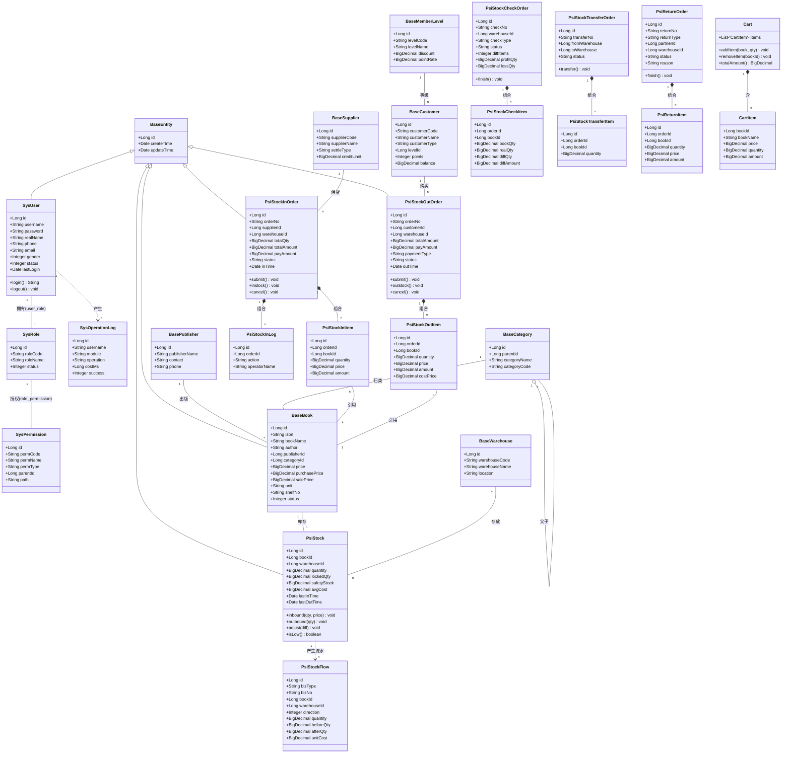

**说明**：
- `BaseEntity` 为抽象基类（提供 `id/createTime/updateTime`），`SysUser`、`BaseBook`、`PsiStock` 及各单据继承之（泛化 `|--`）。
- **组合**（`*--`）：单据与其明细/流水为**强组合**，单据删除时明细级联删除（同生命周期）。
- **聚合/关联**：`BaseCategory` 自关联（`o--`）表达树形父子；`BaseBook` 与 `PsiStock`、`PsiStockInItem` 为普通关联。
- `PsiStock` 封装库存不变量方法 `inbound/outbound/adjust`，是库存一致性的领域入口。
- `Cart/CartItem` 为 POS 收银的**会话态领域对象**（不落库）。

### 2.2 分层类协作

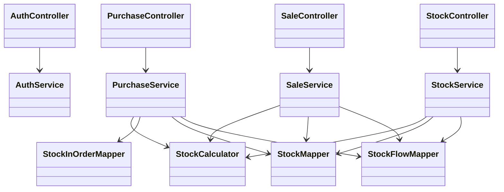

**说明**：Controller 仅做参数校验与编排，Service 承载业务规则，`StockCalculator` 封装移动加权平均成本与库存扣减算法，Mapper 负责持久化。

---

## 3. ER 图

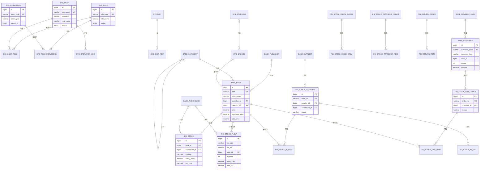

**说明**：ER 图完整呈现 30 张表的实体与关系，与 `02-database/schema.sql` 的 `UNIQUE KEY`（PK/UK）、`FOREIGN KEY` 语义（此处以外键标注，物理脚本未建 FK 约束，由应用层保证）一致。核心实体为 `BASE_BOOK`（商品）、`PSI_STOCK`（库存）、三类单据及其明细、`PSI_STOCK_FLOW`（台账）。

---

## 4. 活动图

### 4.1 活动图 1：进货入库

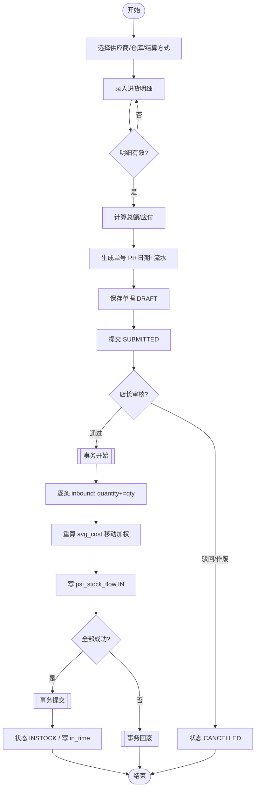

**说明**：进货入库的关键是**事务内的库存批量更新 + 成本重算 + 流水记账**，任一步失败整体回滚，保证账实一致。

### 4.2 活动图 2：销售出库

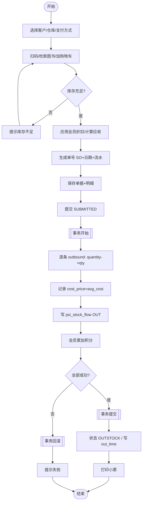

**说明**：销售出库强调**库存校验先行**（`quantity ≥ qty`），不足即中断；成功后同步累计会员积分，体现会员运营。

### 4.3 活动图 3：库存盘点

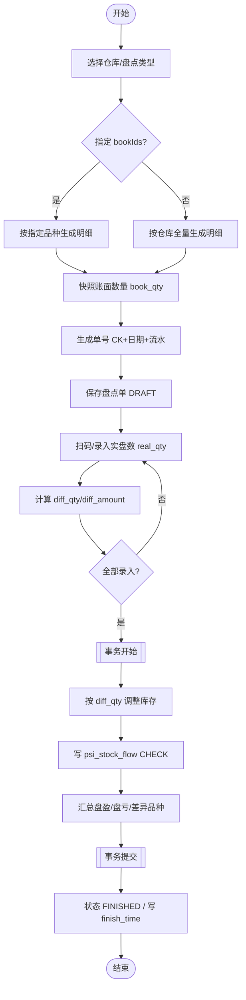

**说明**：盘点是"**账面快照 → 实盘录入 → 差异调整**"三段式，差异通过 `CHECK` 流水固化，`profit_qty/loss_qty` 汇总入单头。

---

## 5. 时序图

### 5.1 时序图 1：登录认证

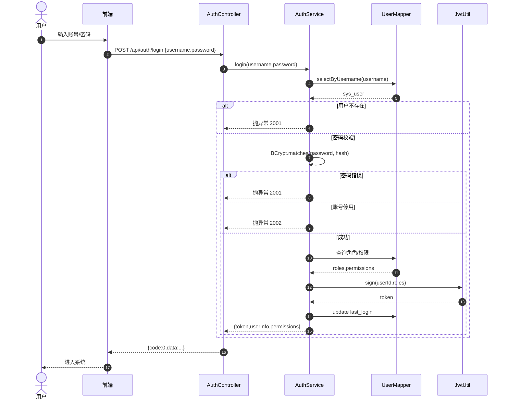

**说明**：认证链路包含**查库 → BCrypt 校验 → 状态校验 → 装载权限 → 签发 JWT → 更新登录时间**，异常统一由全局处理器转为错误码。

### 5.2 时序图 2：进货入库

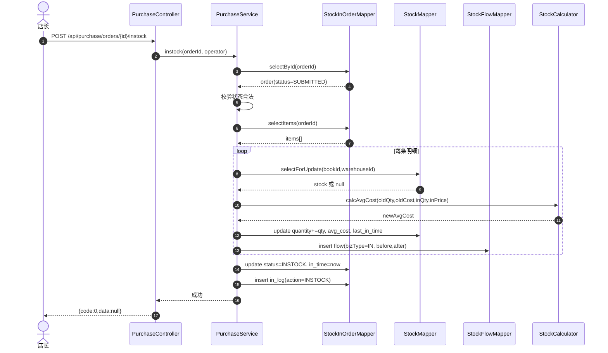

**说明**：库存行使用**悲观锁 `selectForUpdate`** 读取，保证并发下成本与数量计算不丢失更新；所有写入在同一事务内。

### 5.3 时序图 3：销售出库

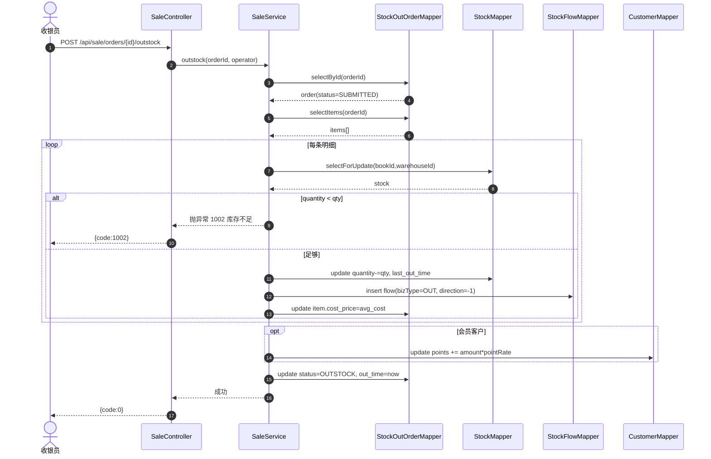

**说明**：出库以**库存校验为闸门**，不足时抛业务异常 `1002`，事务回滚，`cost_price` 固化出库成本用于毛利分析。

### 5.4 时序图 4：扫码盘点

```mermaid
sequenceDiagram
    autonumber
    actor S as 库管员
    participant APP as 移动端/PC扫码
    participant SC as ScanController
    participant QC as QrCodeService
    participant CC as CheckService
    participant SM as StockMapper
    participant CM as CheckItemMapper

    S->>APP: 扫描图书码
    APP->>SC: POST /api/scan/resolve {code:"SHG:BOOK:9787020002207"}
    SC->>QC: resolve(code)
    QC-->>SC: {bizType:"BOOK", entity:isbn}
    SC-->>APP: 识别结果
    APP->>SC: POST /api/mobile/check/scan {checkId,code,realQty}
    SC->>CC: scanInput(checkId,isbn,realQty)
    CC->>CM: selectItemByBook(checkId,bookId)
    CM-->>CC: item(book_qty=120)
    CC->>SM: select(bookId,warehouseId)
    SM-->>CC: avg_cost
    CC->>CC: diff_qty=realQty-book_qty; diff_amount=diff*qty*avg_cost
    CC->>CM: update real_qty,diff_qty,diff_amount,scan_code
    CC-->>SC: 明细更新
    SC->>QC: log scan + scan_count++
    SC-->>APP: {code:0,data:item}
    APP-->>S: 显示差异
```

**说明**：扫码盘点复用 `SHG:BOOK:<isbn>` 规范，服务端负责**码解析 → 明细定位 → 差异计算 → 记录扫码日志**，实现免手输的高效盘点。

---

## 6. 状态图

### 6.1 状态图 1：进货单状态机

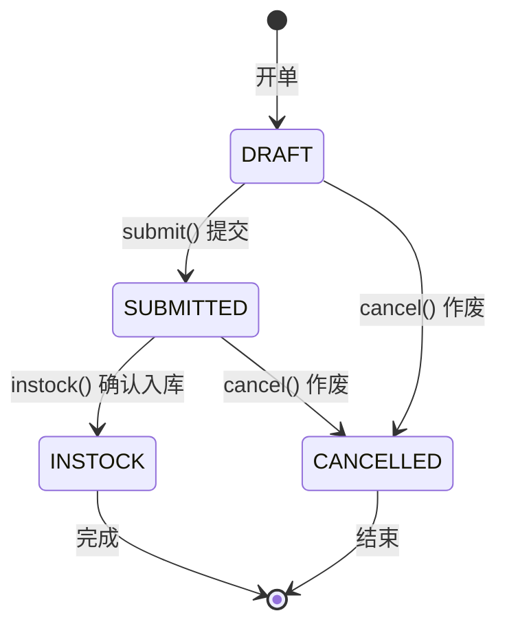

**说明**：`DRAFT→SUBMITTED→INSTOCK` 为主干；`CANCELLED` 为终态。仅 `DRAFT` 可改可删，`INSTOCK` 为不可逆终态（如需冲正走退货单）。

### 6.2 状态图 2：出货单状态机

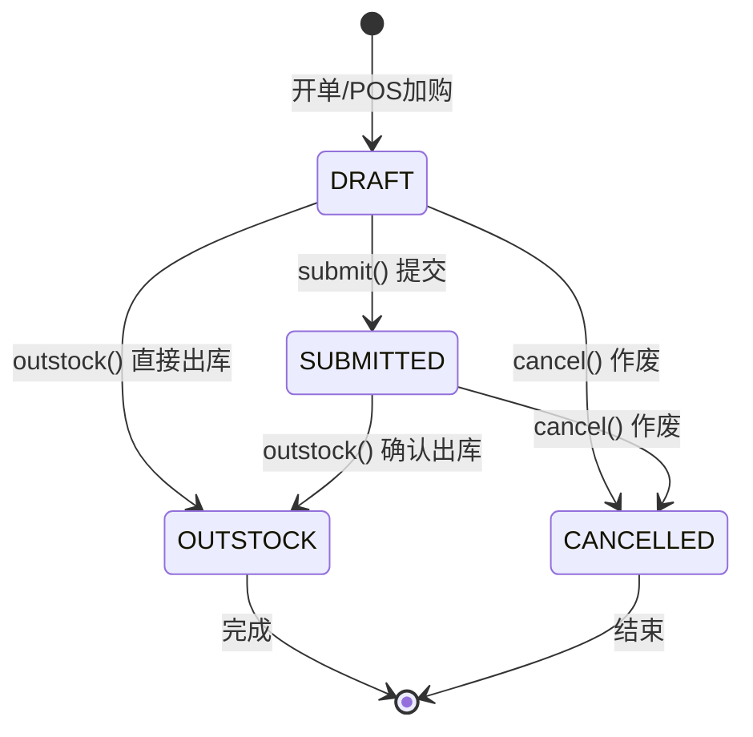

**说明**：出货单支持 `DRAFT` 直接 `OUTSTOCK`（POS 一步收银）与 `DRAFT→SUBMITTED→OUTSTOCK`（先开单后出库）两条路径，`OUTSTOCK` 为终态。

---

## 7. 组件图

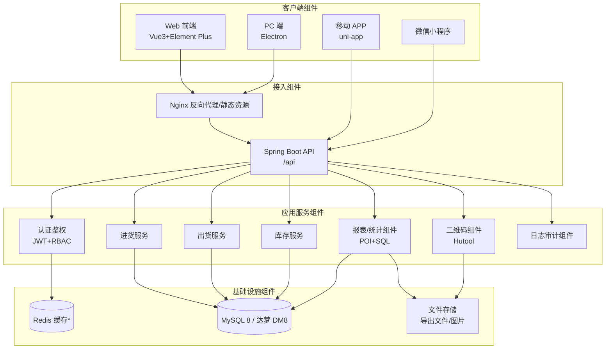

> 注：`Redis 缓存*` 为**可选增强组件**（用于 token 黑名单、热点缓存），基础实现可不依赖。

**说明**：组件图刻画四端经 Nginx/API 网关进入应用服务，服务组件按业务域拆分，统一访问数据库与文件存储。

---

## 8. 部署图

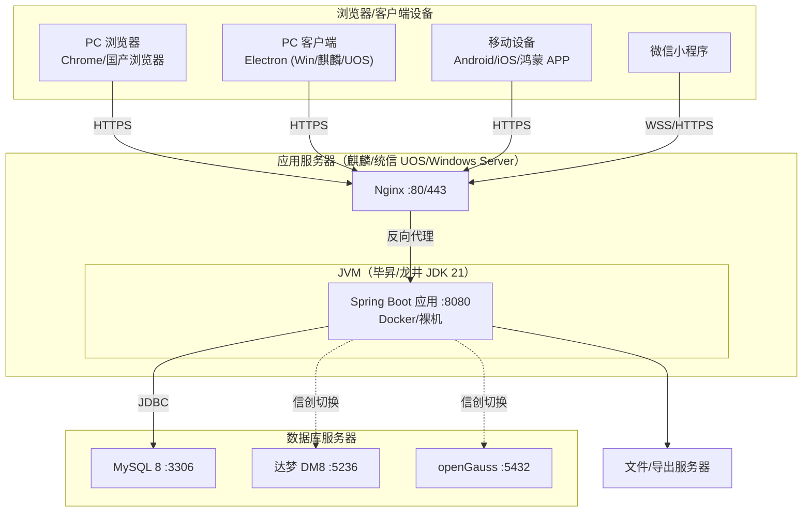

**说明**：应用服务器与数据库服务器分离部署；应用通过 JDBC 连接数据库，通过**数据源配置**在 MySQL/达梦/openGauss 间切换；四端统一经 HTTPS 访问 Nginx。

---

## 9. 分层包图

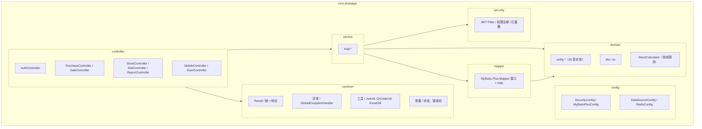

**说明**：采用经典**五层包结构**：`controller（表现/接入）→ service（应用）→ domain（领域模型）`，向下依赖 `mapper（基础设施）`；`common/config/security` 为横切支撑。依赖方向单向向下，避免循环依赖。