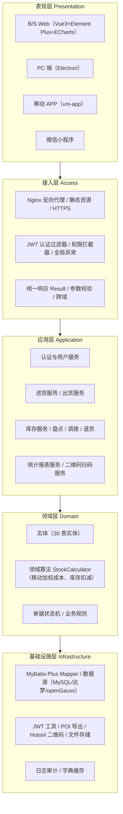
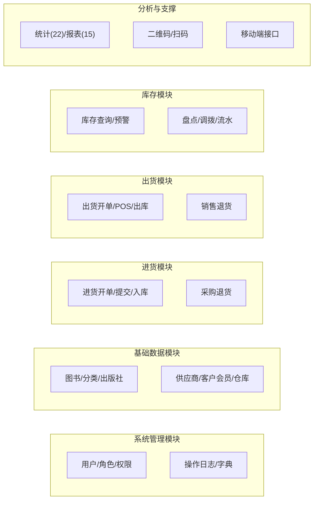
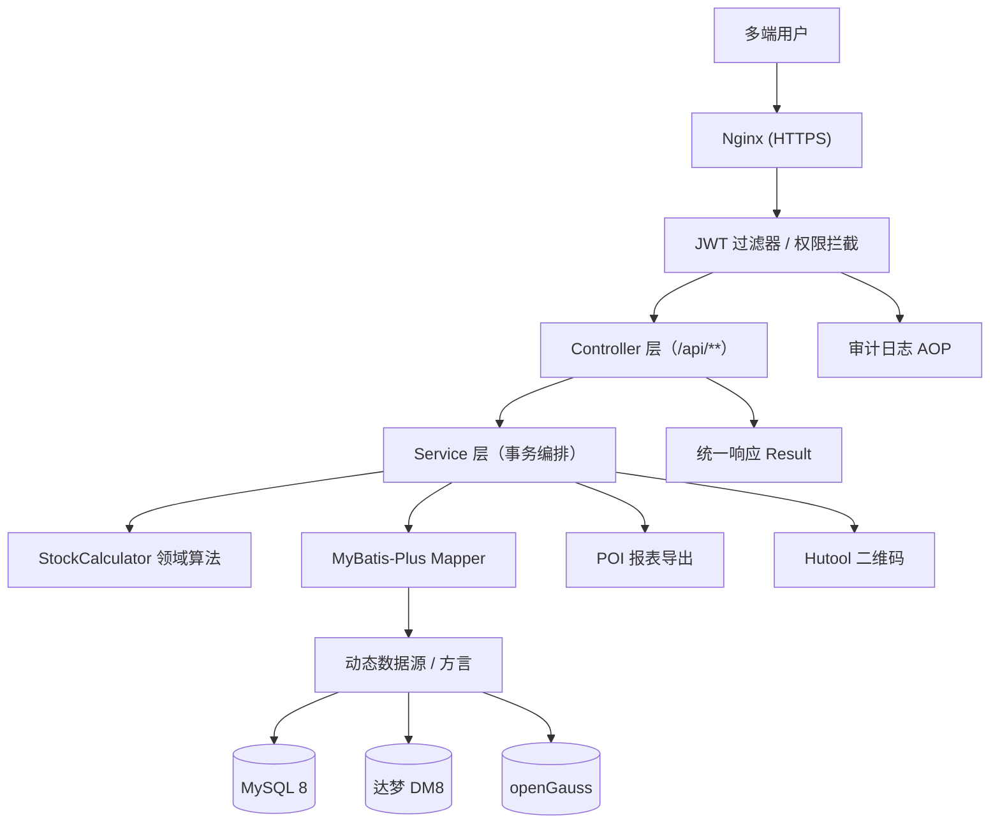
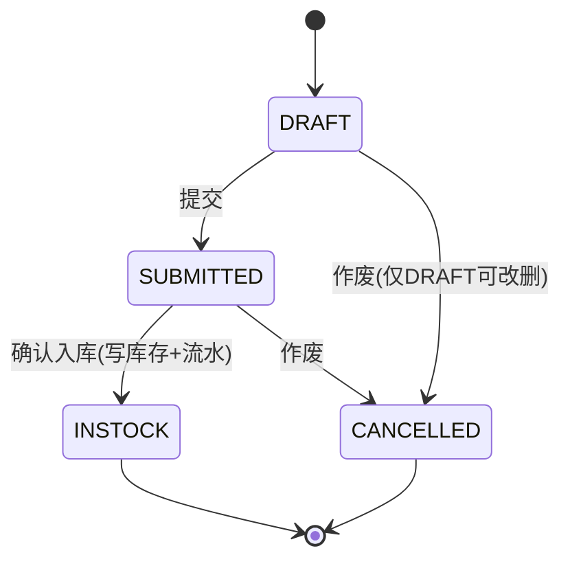
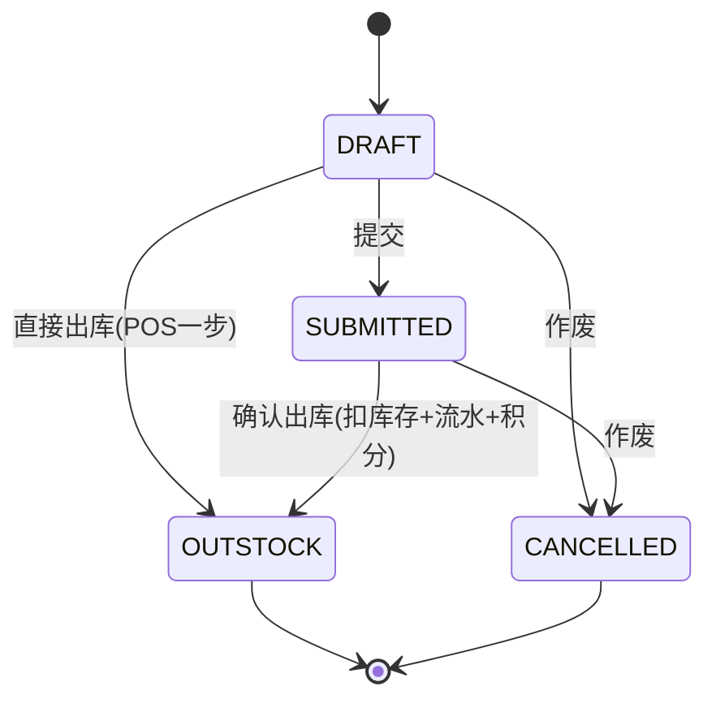
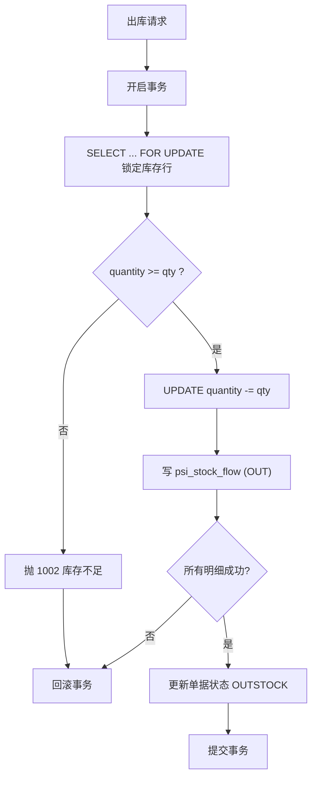
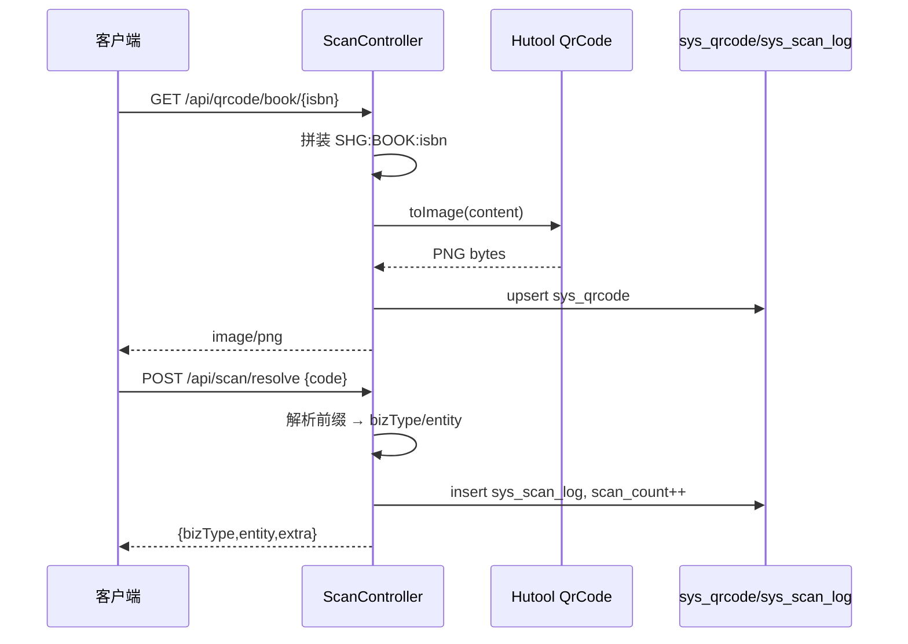
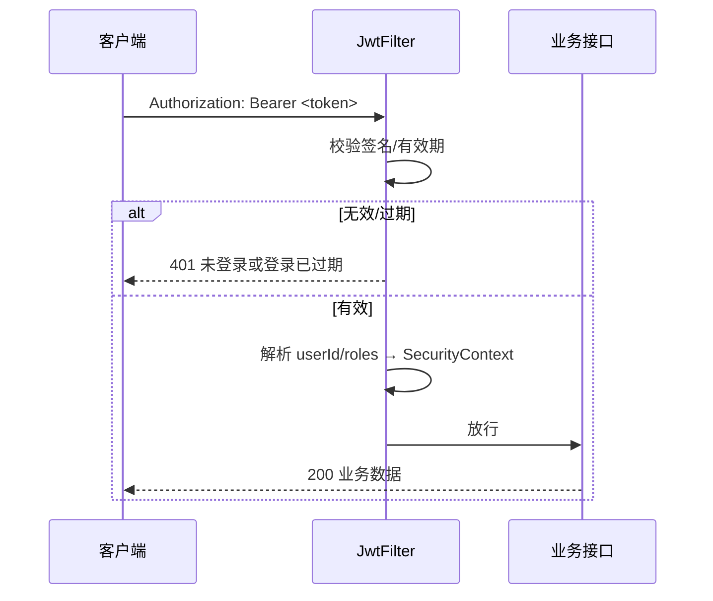

# 07 · 软件架构设计

> 本章给出「晓镜书阁 · 书店进销存管理系统」的总体架构、模块划分、技术架构图，以及核心业务的关键设计：单据状态机、库存一致性、移动加权平均成本算法、二维码体系、安全设计、部署架构与信创适配要点。

---

## 1. 总体架构

系统采用**分层架构 + 前后端分离**，自顶向下分为五层：



| 层次 | 职责 | 关键技术 |
|---|---|---|
| 表现层 | 界面渲染、交互、图表 | Vue3、Element Plus、ECharts、uni-app、Electron |
| 接入层 | 路由、认证、权限、异常、限流 | Nginx、JWT Filter、Spring Security、`@RestControllerAdvice` |
| 应用层 | 用例编排、事务边界、DTO 转换 | Spring `@Service`、`@Transactional` |
| 领域层 | 实体、领域算法、业务规则 | POJOs、`StockCalculator`、状态机 |
| 基础设施层 | 持久化、外部能力 | MyBatis-Plus、POI、Hutool、文件系统 |

---

## 2. 模块划分与职责



| 模块 | 职责 | 关键表 | 依赖 |
|---|---|---|---|
| 系统管理 | 认证、RBAC、审计、字典 | `sys_user/role/permission/*_log/sys_dict*` | — |
| 基础数据 | 主数据维护（图书、往来单位、仓库） | `base_*` | 系统管理 |
| 进货 | 进货单全生命周期、采购退货 | `psi_stock_in_*`、`psi_return_*` | 基础数据、库存算法 |
| 出货 | 出货单、POS 收银、销售退货 | `psi_stock_out_*`、`psi_return_*` | 基础数据、库存算法 |
| 库存 | 库存台账、盘点、调拨、流水 | `psi_stock`、`psi_stock_check_*`、`psi_stock_transfer_*`、`psi_stock_flow` | 基础数据 |
| 分析与支撑 | 统计报表、二维码扫码、移动端 | `sys_qrcode`、`sys_scan_log` | 全部模块（只读） |

---

## 3. 技术架构图



---

## 4. 单据状态机

### 4.1 进货单 `psi_stock_in_order.status`



| 当前状态 | 允许操作 | 流转后 |
|---|---|---|
| DRAFT | 修改、删除、提交、作废 | SUBMITTED / CANCELLED |
| SUBMITTED | 入库、作废 | INSTOCK / CANCELLED |
| INSTOCK | 只读（如需冲正走采购退货） | — |
| CANCELLED | 只读 | — |

### 4.2 出货单 `psi_stock_out_order.status`



| 当前状态 | 允许操作 | 流转后 |
|---|---|---|
| DRAFT | 修改、删除、提交、出库、作废 | SUBMITTED / OUTSTOCK / CANCELLED |
| SUBMITTED | 出库、作废 | OUTSTOCK / CANCELLED |
| OUTSTOCK | 只读（退货走销售退货） | — |
| CANCELLED | 只读 | — |

**其他单据**：盘点单 `DRAFT→FINISHED/CANCELLED`；调拨单 `DRAFT→PENDING→TRANSFERRED/CANCELLED`；退货单 `DRAFT→FINISHED/CANCELLED`。

**实现要点**：状态校验集中在 Service（如 `assertStatus(order, DRAFT)`），非法流转抛 `code=1003`；状态变更与业务副作用（库存、流水）在**同一事务**内完成。

---

## 5. 库存一致性设计

### 5.1 并发场景

多终端（BSS/APP/小程序/POS）可能对同一 `psi_stock`（`book_id+warehouse_id`）并发读改，导致**丢失更新**与**超卖**。

### 5.2 一致性策略

| 策略 | 说明 | 适用 |
|---|---|---|
| **悲观锁**（`SELECT ... FOR UPDATE`） | 出/入库前锁定库存行，串行化修改 | 出库/入库核心路径（选定） |
| **乐观锁**（`version` 或数量条件更新） | `UPDATE ... SET quantity=quantity-#{qty} WHERE quantity>=#{qty}` | 轻量、可重试场景 |
| **唯一约束** | `uk_stock_book_wh(book_id,warehouse_id)` 防重复库存行 | 期初/新建库存 |
| **事务**（`@Transactional`） | 单据状态 + 库存 + 流水原子提交 | 全部写操作 |
| **锁定库存** | `locked_qty` 记录已下单未出库占用 | 预订/待出库 |



**断言**：库存扣减条件更新 SQL（乐观兜底）：
```sql
UPDATE psi_stock SET quantity = quantity - #{qty}, last_out_time = NOW()
WHERE book_id=#{bookId} AND warehouse_id=#{whId} AND quantity >= #{qty};
-- 影响行数=0 视为库存不足
```

---

## 6. 移动加权平均成本算法

### 6.1 公式

每次**入库**后重算单位成本（`psi_stock.avg_cost`，精度 `DECIMAL(14,4)`）：

$$
\text{newAvgCost} = \frac{\text{oldQty} \times \text{oldAvgCost} + \text{inQty} \times \text{inPrice}}{\text{oldQty} + \text{inQty}}
$$

- 首次入库（`oldQty=0`）：`newAvgCost = inPrice`。
- **出库不改动** `avg_cost`（出库成本取当时 `avg_cost` 固化到 `psi_stock_out_item.cost_price`）。

### 6.2 算法实现（伪代码）

```java
BigDecimal calcAvgCost(BigDecimal oldQty, BigDecimal oldCost,
                       BigDecimal inQty, BigDecimal inPrice) {
    BigDecimal newQty = oldQty.add(inQty);
    if (newQty.compareTo(BigDecimal.ZERO) <= 0) return BigDecimal.ZERO;
    // (oldQty*oldCost + inQty*inPrice) / newQty，保留 4 位 HALF_UP
    return oldQty.multiply(oldCost)
                 .add(inQty.multiply(inPrice))
                 .divide(newQty, 4, RoundingMode.HALF_UP);
}
```

### 6.3 一致性要点

- 入库时**先锁定库存行**再读取 `oldQty/oldCost` 计算，避免并发误差。
- 退货入库（`RET_SAL`）按原销售成本或退货价回冲；采购退货（`RET_PUR`）按 `avg_cost` 冲减，`avg_cost` 保持不变（简化口径，可在文档约定升级为"重新计算"）。

---

## 7. 二维码体系

### 7.1 内容规范

| 类型 | 内容 | 示例 |
|---|---|---|
| 图书 | `SHG:BOOK:<isbn>` | `SHG:BOOK:9787020002207` |
| 单据 | `SHG:ORDER:<orderNo>` | `SHG:ORDER:SO20260905001` |
| 库存位 | `SHG:STOCK:<warehouseId>:<isbn>` | `SHG:STOCK:1:9787020002207` |
| 盘点 | `SHG:CHECK:<checkNo>:<isbn>` | `SHG:CHECK:CK20260930001:9787506365437` |

### 7.2 生成与解析流程



**要点**：内容由**服务端统一生成**，`sys_qrcode` 记录 `biz_type/biz_id/qr_content/scan_count`；解析按前缀路由；`sys_scan_log` 记录设备与结果。

---

## 8. 安全设计

### 8.1 认证（JWT）



- Token 载荷含 `userId`、`roles`；有效期默认 2 小时；登出加入黑名单（可选 Redis）。
- 密码 **BCrypt** 加盐存储（`data.sql` 初始密文对应 `123456`）。

### 8.2 授权（RBAC）

- 三层模型：`sys_user` ↔ `sys_user_role` ↔ `sys_role` ↔ `sys_role_permission` ↔ `sys_permission`。
- 鉴权粒度：菜单/按钮/API（`perm_type=MENU/BUTTON/API`）。
- 实现：`@PreAuthorize` 或自定义 `@RequiresPermission("psi:stockIn:add")`；无权限返回 `403/code=3001`。
- 前端按 `permissions` 渲染菜单与按钮。

### 8.3 审计

- **操作日志**：AOP 切面拦截关键写操作，记录 `sys_operation_log`（`module/operation/method/params/ip/cost_ms/success/error_msg`）。
- **扫码日志**：`sys_scan_log`。
- **单据操作流水**：`psi_stock_in_log` 记录单据关键动作。

### 8.4 其他安全措施

| 措施 | 说明 |
|---|---|
| 参数校验 | `@Valid` + 自定义校验，防注入/越界 |
| SQL 安全 | MyBatis `#{}` 预编译，杜绝字符串拼接 |
| 金额精度 | `DECIMAL` 类型 + `BigDecimal`，避免浮点误差 |
| 敏感数据 | 会员手机号等最小化采集；日志脱敏 |
| 传输安全 | HTTPS（Nginx 证书） |
| 幂等 | 关键操作（入库/出库）状态机 + 事务保证 |

---

## 9. 部署架构

见 [03-UML图集 §8 部署图](03-UML图集.md)。要点：

- **客户端**：B/S、PC（Electron）、APP（uni-app）、小程序四端统一经 HTTPS 访问 Nginx。
- **应用服务器**：Nginx（静态资源 + 反向代理）+ Spring Boot 应用（8080）。
- **数据库服务器**：MySQL 8（主）/ 达梦 DM8 / openGauss，通过**数据源配置 + 方言**切换。
- **文件服务**：导出文件、二维码图片存储。
- 建议：应用与数据库分离部署；数据库主从/备份保障可用性。

---

## 10. 信创适配要点

| 层面 | 要点 | 详见 |
|---|---|---|
| 数据库 | 通用 SQL 子集；类型/分页/自增/函数方言适配 | `02-database/dm/`、[10-信创适配方案](10-信创适配方案.md) |
| 操作系统 | Spring Boot 跨平台；Electron 打麒麟/UOS 包 | [10](10-信创适配方案.md) |
| CPU/JDK | 鲲鹏/飞腾/龙芯 + 毕昇/龙井 JDK 21 | [10](10-信创适配方案.md) |
| 移动端 | uni-app 鸿蒙构建 | [10](10-信创适配方案.md) |
| 前端 | 兼容国产浏览器（Chromium 内核） | [10](10-信创适配方案.md) |

---

## 11. 设计原则小结

1. **单一职责**：Controller/Service/Mapper 各司其职，`StockCalculator` 独占库存算法。
2. **事务边界清晰**：单据状态 + 库存 + 流水同事务，保证账实一致。
3. **状态驱动**：所有单据以显式状态机约束操作合法性。
4. **可移植**：SQL 通用子集 + 适配层，实现多库运行。
5. **可观测**：统一响应、统一异常、审计日志，便于排障。
6. **安全内建**：认证、授权、审计、参数校验贯穿全链路。