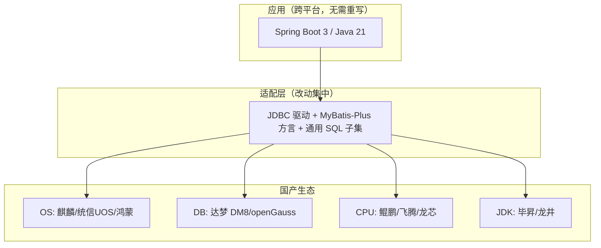

# 10 · 信创适配方案

> 本章给出「晓镜书阁 · 书店进销存管理系统」在**信创（信息技术应用创新）**环境下的适配方案：操作系统、国产数据库、国产 CPU 与 JDK、前端 Electron、移动端鸿蒙化，以及迁移步骤与验证清单。
> 数据库脚本与差异说明见 `02-database/dm/`。

---

## 1. 信创适配总体目标

| 目标 | 说明 |
|---|---|
| 全栈可替代 | OS、数据库、CPU、JDK 均可切换为国产产品 |
| 一次开发多库运行 | 以通用 SQL 子集 + 适配层支持 MySQL/达梦/openGauss |
| 最小改造 | 通过配置与方言适配，避免业务代码大改 |
| 可验证 | 提供迁移步骤与验证清单，确保可交付 |

---

## 2. 操作系统适配

| 目标 OS | 版本 | 适配点 | 措施 |
|---|---|---|---|
| 麒麟 Kylin (银河/中标) | V10 | 服务器/桌面 | Spring Boot 跨平台运行；Electron 打 `.deb`/AppImage 包 |
| 统信 UOS | 20/1060 | 服务器/桌面 | 同上；验证中文字体与打印 |
| 鸿蒙 HarmonyOS | NEXT | 移动端 | uni-app 鸿蒙构建；验证扫码与网络 |
| Windows Server | 2016+ | 传统服务器 | 兼容基线 |

**服务器侧**：Java 跨平台，只需确保目标 OS 安装兼容 JDK 与 Nginx（麒麟/UOS 软件源提供）。**桌面侧**：Electron 需针对目标 OS 打包（`electron-builder`），并验证输入法、字体、小票打印驱动。

---

## 3. 国产数据库适配

### 3.1 达梦 DM8

| 差异类别 | MySQL | 达梦 DM8 | 处理 |
|---|---|---|---|
| 自增 | `AUTO_INCREMENT` | `IDENTITY(1,1)` | 建表改写（见 `dm-schema.sql`） |
| 日期时间 | `DATETIME` | `TIMESTAMP` | 类型映射 |
| 布尔/微整 | `TINYINT` | `TINYINT`/`SMALLINT` | 映射为 `TINYINT`（兼容） |
| 默认时间 | `DEFAULT CURRENT_TIMESTAMP` | `DEFAULT SYSDATE`/`CURRENT_TIMESTAMP` | 改写默认值 |
| `ON UPDATE CURRENT_TIMESTAMP` | 支持 | 不支持 | 用**触发器**或应用层维护 `update_time` |
| 字符串 | `VARCHAR` | `VARCHAR`（默认按字节，可配字符） | 配置字符集 UTF-8，注意长度按字符 |
| 分页 | `LIMIT n OFFSET m` | `LIMIT m, n` 或 `LIMIT n OFFSET m`（视版本） | 统一封装分页 |
| 注释 | 行内 `COMMENT` | `COMMENT ON COLUMN` | 建表后单独加注释 |
| 函数 | `IFNULL/DATE_FORMAT/DATE_SUB` | `NVL/TO_CHAR/ADD_DAYS` | SQL 适配层替换 |

### 3.2 openGauss

| 差异类别 | MySQL | openGauss | 处理 |
|---|---|---|---|
| 自增 | `AUTO_INCREMENT` | `SERIAL`/`IDENTITY` | 改写 |
| 日期 | `DATETIME` | `TIMESTAMP` | 映射 |
| 函数 | `IFNULL` | `NVL`/`COALESCE` | 替换 |
| 分页 | `LIMIT m,n` | `LIMIT n OFFSET m` | 统一 `LIMIT/OFFSET` |
| 大小写 | 不敏感默认 | 标识符默认小写 | 统一小写命名 |

### 3.3 兼容策略

- **SQL 子集**：仅在 MyBatis XML 中使用三方共有的 SQL 语法；对函数差异封装为**方言适配**。
- **MyBatis-Plus**：启用 `DbType` 分页方言（`mysql`/`dm`/`postgresql`），自动适配分页。
- **DDL 分离**：MySQL 用 `schema.sql`，达梦用 `dm/dm-schema.sql`，openGauss 可基于达梦脚本微调。

---

## 4. 国产 CPU 与国产 JDK 适配

| CPU 架构 | 代表芯片 | JDK 选择 | 说明 |
|---|---|---|---|
| ARM64 | 鲲鹏 920、飞腾 | 毕昇 JDK 21 / 龙井 JDK 21 / OpenJDK ARM64 | Spring Boot 3 已适配 |
| LoongArch | 龙芯 3A5000+ | 龙井/龙芯 JDK 21 | 需确认 JDK 版本支持 LoongArch |
| x86_64 | 海光/兆芯 | OpenJDK / 毕昇 | 兼容性最好 |

**适配要点**：
- 使用 **Java 21 LTS**（长期支持，国产生态跟进良好）；避免使用依赖 JNI 的第三方本地库。
- Hutool、POI、MyBatis-Plus 均为纯 Java，无架构相关本地库，跨 CPU 无障碍。
- Electron/Node 需下载对应架构（ARM64/LoongArch）的 Node 与 Electron 发行包。
- 压测在目标 CPU 上复核性能（ARM 与 x86 存在差异）。

---

## 5. 前端 Electron 信创化

| 适配点 | 措施 |
|---|---|
| 打包 | `electron-builder` 输出麒麟/UOS 的 `.deb`、`AppImage`（ARM64/LoongArch） |
| 字体 | 内置或依赖系统字体（思源黑体等），避免乱码 |
| 输入法 | 验证 fcitx/ibus 中文输入 |
| 打印 | 适配国产小票/针式打印机驱动（CUPS） |
| 扫码枪 | USB CDC/HID 模拟键盘，跨 OS 一致 |
| 内核 | Electron 内嵌 Chromium，规避国产浏览器差异 |
| 安全 | 关闭远程调试；校验更新包签名 |

---

## 6. 移动端鸿蒙化

| 适配点 | 措施 |
|---|---|
| 构建 | uni-app 提供鸿蒙（HarmonyOS NEXT）构建目标 |
| 扫码 | 鸿蒙相机/扫码 API 适配 uni-app 插件 |
| 网络 | HTTPS 请求走鸿蒙网络能力 |
| 权限 | 相机、存储权限声明 |
| 兼容 | 保留 Android/iOS 构建，三端同源 |

---

## 7. 迁移步骤（MySQL → 达梦/openGauss）

**详细步骤**：

1. **环境准备**：目标机安装达梦 DM8/openGauss；安装对应 JDBC 驱动（`DmJdbcDriver18.jar` / `opengauss-jdbc.jar`）。
2. **结构迁移**：执行 `02-database/dm/dm-schema.sql`（已处理类型/自增/默认值差异）；补充 `COMMENT ON` 语句。
3. **数据迁移**：使用达梦 DTS / openGauss `gs_dump` 或导出 CSV + `LOAD DATA` 导入；主数据 → 单据 → 流水的顺序导入以保证引用完整。
4. **应用配置**：修改数据源 URL/驱动类；配置 MyBatis-Plus `DbType`；替换方言函数（`IFNULL→NVL` 等）。
5. **功能验证**：按用例 UC01~UC40 回归；重点验证进货入库、销售出库、盘点、调拨、退货、统计报表。
6. **性能验证**：并发收银、报表导出、大表查询压测；必要时加索引/调参。
7. **上线切换**：灰度/割接，准备**回滚预案**（保留 MySQL 只读或双写过渡期）。

---

## 8. 验证清单

| # | 验证项 | 方法 | 通过标准 |
|---|---|---|---|
| 1 | 建表脚本执行 | 执行 `dm-schema.sql` | 30 张表全部创建成功 |
| 2 | 数据初始化 | 导入 `data.sql` 等价数据 | 40 图书/6 用户/权限/样例单据齐备 |
| 3 | 登录鉴权 | 登录 admin/123456 | 返回 token，权限正确 |
| 4 | 进货入库 | UC16→UC19 | 库存增加、`avg_cost` 重算、流水生成 |
| 5 | 销售出库 | UC22→UC25 | 库存扣减、`cost_price` 固化、积分累计 |
| 6 | 库存不足回滚 | 出库超量 | 返回 1002 且库存不变 |
| 7 | 盘点差异调整 | UC30→UC32 | 库存按差异调整、`CHECK` 流水生成 |
| 8 | 库存调拨 | UC33 | 两仓联动、`TRANSFER_*` 流水生成 |
| 9 | 采购/销售退货 | UC21/UC27 | 库存与流水正确、状态 FINISHED |
| 10 | 二维码 | UC37/UC38 | 生成/解析 `SHG:BOOK:<isbn>` 正确 |
| 11 | 统计 22 项 | 调用 `/api/stat/**` | 数据与 MySQL 环境一致 |
| 12 | 报表 15 张 | 调用 `/api/report/**` + 导出 | 数据一致、Excel/CSV 可打开 |
| 13 | 中文与字符集 | 含中文检索/导出 | 无乱码 |
| 14 | 分页 | 列表翻页 | 结果正确、无重复/遗漏 |
| 15 | 时间字段 | 新增单据 | `create_time/update_time` 正确写入 |
| 16 | 性能 | 压测 | 满足性能指标（见 [02 §5.1](02-需求分析与用例.md)） |
| 17 | 国产 OS 运行 | 麒麟/UOS 部署 | 应用启动、页面正常 |
| 18 | Electron 信创包 | 麒麟/UOS 安装 | 可启动、扫码/打印可用 |

---

## 9. 适配风险与应对

| 风险 | 影响 | 应对 |
|---|---|---|
| 方言函数差异遗漏 | 统计/报表报错 | 建立 SQL 适配层与自动化回归 |
| `ON UPDATE CURRENT_TIMESTAMP` 不支持 | `update_time` 不更新 | 触发器或应用层显式赋值 |
| ARM/LoongArch 性能差异 | 响应变慢 | 目标环境压测与调优 |
| Electron 打包依赖 | 无法安装 | 提前准备目标架构 Electron/Node 包 |
| 鸿蒙 NEXT API 变更 | 移动端扫码异常 | 跟随 uni-app 官方适配版本升级 |
| 数据迁移完整性 | 数据丢失 | 迁移后行数与抽样校验、保留回滚 |

---

## 10. 小结

本方案以**通用 SQL 子集 + 适配层**为核心，实现数据库层的平滑迁移；以**跨平台技术栈（Java/Electron/uni-app）**实现 OS 与 CPU 层的可移植；并提供**迁移步骤与 18 项验证清单**保障信创环境下的可交付性。配套脚本见 `02-database/dm/dm-schema.sql` 与 `02-database/dm/dm-adaptation-notes.md`。