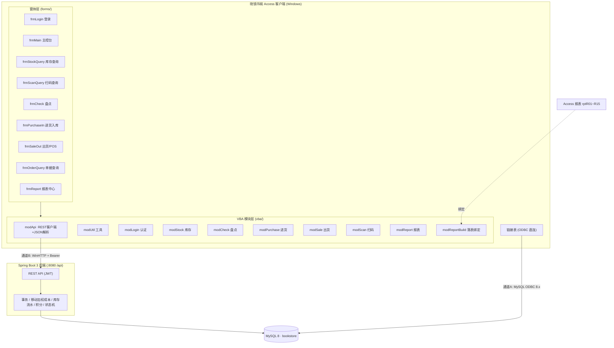

# 11 · Access 客户端设计

> 本文档描述 **晓镜书阁 · Microsoft Access 桌面客户端**（PC 端交付物之一）的设计。
> 接口契约见 [09-接口设计](09-接口设计.md)，数据库结构见 [08-数据库设计](08-数据库设计.md)。
> 交付物位于 [`08-access-client/`](../08-access-client/README.md)。

## 1. 目标与范围

### 1.1 目标
- 为既有 Windows + Office 环境的门店提供**轻量、零依赖中间件**的 PC 桌面客户端。
- 覆盖三大关键场景：**库存盘点、在线查询、扫码办事**。
- 与现有 Spring Boot 后端（`/api`）联通，保证与 Web / APP 端**数据一致**。

### 1.2 范围
| 包含 | 不包含 |
|---|---|
| 登录、库存查询/预警/概览、扫码查询、二维码展示 | 系统管理（用户/角色/权限维护，仍由 Web 端负责） |
| 盘点（建单/扫码录入/完成/作废） | 复杂基础数据维护（图书/供应商大批量维护） |
| 进货入库、出货/POS 出库 | 后端/数据库实现（已有交付物） |
| 单据查询、15 张报表预览/打印/导出 | 移动端、小程序（已有交付物） |

### 1.3 交付形态
因 Access 无法在无 Office 环境中生成二进制，交付为 **可导入 VBA 源码（10 个模块）+ 9 个窗体规格 + 15 张报表规格 + 分步搭建指南 + ODBC/查询脚本**，用户可在 Access 中照指南组装出可运行 `.accdb/.accde`。

## 2. 总体结构（双通道架构）

**通道 A（链接表 / 读）**：Access 经 MySQL ODBC 链接后端表，用于基础数据浏览、库存结存、报表直连。
**通道 B（REST API / 写）**：`modApi` 用 WinHTTP 调 `/api/*`，承载登录与全部业务写操作，复用后端事务与成本逻辑。

> 分工原则：**读走 A（快、轻），写走 B（一致、可控）**。不通过 Access 直接修改库存表，避免绕过移动加权成本与流水。

## 3. 模块清单

| 模块 | 关键函数 | 对应接口 |
|---|---|---|
| `modApi` | `ApiGet/ApiPost/ApiPut/ApiDel`、`JsonParse`、`JsonPath`、`ApiGetBinary`、`Utf8Bytes/Utf8String` | 通用（WinHTTP + 自研 JSON 解析，无第三方依赖） |
| `modUtil` | `FmtMoney/FmtNum/FmtDate`、`JsonEsc/JStrPair/JNumPair`、`UrlEnc/Q`、`MsgInfo/MsgErr` | 工具 |
| `modLogin` | `DoLogin`、`CurrentToken`、`HasPerm/HasRole`、`DoLogout` | §2 认证 |
| `modStock` | `StockList/StockWarnings/StockSummary/StockFlows/MobileStockQuick` | §7、§11 |
| `modCheck` | `ListCheckOrders/GetCheckOrder/CreateCheckOrder/ScanCheck/PutCheckItems/FinishCheck` | §7、§11 |
| `modPurchase` | `ListPurchaseOrders/GetPurchaseOrder/InstockOrder` | §5 |
| `modSale` | `ListSaleOrders/PosSearch/CreateSaleOrder/OutstockOrder` | §6 |
| `modScan` | `ResolveScan/LogScan/ParseScanCode/SaveBookQRCode/SaveOrderQRCode` | §10 |
| `modReport` | `GetReport/ExportReport/ReportCatalog` | §9 |
| `modReportBuild` | `BuildReportTable/PreviewReport/PrintReport` | §9（动态落表 + 绑定报表） |

## 4. 关键界面说明

| 窗体 | 职责 | 关键交互 |
|---|---|---|
| `frmLogin` | 登录 | `POST /auth/login`，token 存全局变量 |
| `frmMain` | 主控台/导航 | 库存概览 KPI、全局扫码框、各模块入口 |
| `frmStockQuery` | 库存在线查询 | `GET /stock/list`，结果落 `tmpStockList`，支持预警/导出 |
| `frmScanQuery` | **扫码办事核心** | 扫码枪输入 → `GET /mobile/stock/quick`，展示图书+库存+货架位+二维码 |
| `frmCheck` | **库存盘点** | 选单 → 扫码录入（`/mobile/check/scan`）→ 提交（`PUT .../items`）→ 完成（`/finish`） |
| `frmPurchaseIn` | 进货入库 | 列表/明细 + `POST /purchase/orders/{id}/instock` |
| `frmSaleOut` | 出货/POS | `GET /sale/pos/search` 检索 + 结算出库 |
| `frmOrderQuery` | 单据查询 | 进销/盘点单统一查询 + 单据二维码 |
| `frmReport` | 报表中心 | R01~R15 取数/预览/打印/导出 |

**扫码机理**：扫码枪在系统中等价于键盘设备，扫到条码后自动发送**回车**。窗体用文本框接收，`KeyDown(vbKeyReturn)` 事件触发查询/录入，无需任何驱动或中间件。

## 5. 与 Web 端的一致性

| 维度 | 保证方式 |
|---|---|
| 认证 | 同一 `/auth/login`、同一 JWT、同一 `Authorization: Bearer` 头 |
| 业务逻辑 | 写操作全部走 REST API，复用后端事务、移动加权成本、库存流水、积分、状态机 |
| 字段命名 | API 层驼峰（`bookName`，与 Web 相同）；SQL 直连下划线（`book_name`） |
| 状态机 | `DRAFT/SUBMITTED/INSTOCK/OUTSTOCK/CANCELLED/FINISHED` 与后端一致 |
| 报表 | 同一 `/report/{code}` 契约，列与顺序与 Web 导出一致 |
| 扫码 | `/scan/resolve`、`/mobile/check/scan`、`/mobile/stock/quick` 与 APP 同源 |

## 6. 部署与打包

| 项 | 说明 |
|---|---|
| 运行环境 | Windows + Access（或免费 **Access Runtime**） |
| 打包 | 文件 → 另存为 → **Make ACCDE**，隐藏 VBA 源码；终端只需 Runtime 即可运行 |
| 配置 | `modApi.API_BASE` 指向后端；DSN `SHG-MySQL` 指向 MySQL（通道 A） |
| 分发 | `.accde` + `sql/` 说明；首启若后端不可达给出明确提示 |
| 更新 | 前端逻辑变更后可重发 `.accde`；接口变更只需对齐 `09-接口设计.md` |

## 7. 优缺点与信创分工

### 7.1 优点
- 零额外中间件：使用系统自带 WinHTTP / ADODB / Scripting；JSON 解析自研，无第三方依赖。
- 报表能力强：Access 报表对分组、汇总、打印、导出（PDF/Excel）支持成熟。
- 落地快：面向既有 Office 环境的门店，几乎无改造成本。
- 双通道兼顾：读写分离，既快又一致。

### 7.2 缺点 / 风险
- **仅 Windows**：依赖 Office/Access，不跨平台、不适配国产 OS。
- 二进制格式不利版本管理（故以源码 + 规格交付）。
- Access 直接连库的性能受 ODBC 与网络影响，大表需加条件查询。

### 7.3 信创分工
- Access 端定位**存量 Windows/Office 门店**的快速交付；
- 信创（麒麟/统信 UOS/鸿蒙）环境由 **Electron 客户端（`05-pc-electron/`）** 承接；
- 两端共用同一后端 REST API，业务与数据一致，可按现场环境二选一部署；
- 国产化替代 Access 的路径：WPS 表格 + 宏 / 达梦或 openGauss + 自研客户端 / 直接采用 Electron 端。

## 8. 交付物清单

| 路径 | 内容 |
|---|---|
| `08-access-client/README.md` | 总览 + 分步搭建指南 + 关键场景操作 |
| `08-access-client/vba/` | 10 个可导入 VBA 模块 |
| `08-access-client/forms/` | 9 个窗体规格 |
| `08-access-client/reports/reports-spec.md` | R01~R15 报表规格 |
| `08-access-client/sql/linked-tables.md` | ODBC 链接表与 DSN 配置 |
| `08-access-client/sql/access-queries.sql` | Access 直连查询 + 方言对照 |
| `08-access-client/assets/create-accdb-steps.md` | 组装清单 |
| `08-access-client/assets/import-odbc.reg` | DSN 注册表模板 |